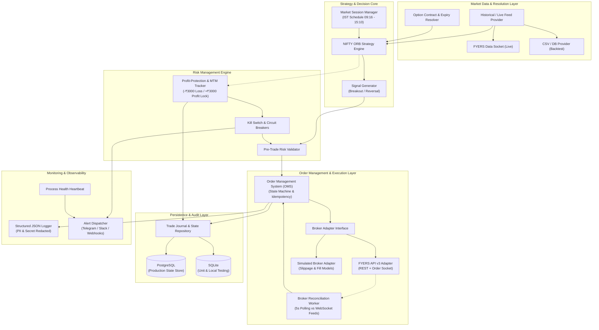

# System Architecture Specification: MyTradeView

## 1. Executive Summary

`MyTradeView` is an institutional-grade, event-driven algorithmic trading executor built in Python 3.10+ tailored for automated index options trading on the National Stock Exchange of India (NSE). It interfaces directly with the FYERS brokerage platform via FYERS API v3. 

The primary objective is the faithful execution of a validated **NIFTY Opening Range Breakout (ORB)** intraday strategy originally modeled and backtested on **StockMock**. The architecture guarantees strict determinism, risk containment, idempotent execution, persistent state reconciliation, and decoupled data providers.

---

## 2. Core Architectural Principles

1. **Safety-First / Zero Blind Execution:** Live trading is hard-disabled by default (`EXECUTION_MODE=simulation`). Enabling live trading requires explicit dual-flag activation in configuration.
2. **Decoupled Architecture:** Clean separation of concerns across 12 discrete, independently testable modules. The Strategy Engine has zero knowledge of FYERS-specific APIs; it consumes abstract data events and emits strategy signals.
3. **Strict Order Fill Verification:** Never assume order submission implies fill. Order execution is an asynchronous state machine driven by exchange fill events and verified via broker reconciliation.
4. **Idempotency & Duplicate Prevention:** Every order carries an idempotent client order identifier (`order_tag`). Process restarts recover state from PostgreSQL without duplicate order firing.
5. **Reversal Sequencing:** When reversing positions (CE $\to$ PE or PE $\to$ CE), the engine enforces atomic sequence: **Close Existing Position $\to$ Confirm Fill $\to$ Open New Position**. Naked double-exposure or simultaneous opposing positions are physically prevented.
6. **No API Hallucinations:** All broker interactions adhere strictly to verified FYERS API v3 endpoints, parameter types, error payloads, and websocket schemas.

---

## 3. High-Level System Architecture



---

## 4. The 12 Architectural Modules

### Module 1: Strategy Engine (`src/strategy/`)
- **Responsibilities:**
  - Maintains state of the opening range (09:16:00 to 09:45:00 IST).
  - Evaluates NIFTY Spot price ticks/bars against established Opening Range High (ORH) and Opening Range Low (ORL).
  - Emits directional signals (`ENTER_LONG_CE`, `ENTER_LONG_PE`, `CLOSE_CE`, `CLOSE_PE`, `SQUARE_OFF`).
  - Maintains current strategy position status (`FLAT`, `LONG_CE`, `LONG_PE`).
- **Interfaces:**
  - `BaseStrategy`: Abstract interface defining `on_bar(bar)`, `on_tick(tick)`, `on_order_update(update)`.
  - Pure deterministic state machine free of network or broker dependencies.

### Module 2: Historical Market-Data Provider (`src/data/`)
- **Responsibilities:**
  - Abstracts historical candle fetching and live stream consumption.
  - Provides uniform candle objects (`timestamp`, `open`, `high`, `low`, `close`, `volume`).
  - Implements FYERS REST `/api/v3/history` pagination and resolution parsing.
  - Implements CSV/Parquet reader for reproducible historical backtesting.
- **Interfaces:**
  - `MarketDataProvider`: Abstract base class with `get_history(symbol, resolution, start, end)` and `subscribe(symbols)`.

### Module 3: Option-Contract & Expiry Resolver (`src/data/symbol_resolver.py`)
- **Responsibilities:**
  - Identifies the active weekly expiry date for NIFTY options (Thursday or preceding business day for holidays).
  - Resolves ATM strike: $\text{Strike}_{\text{ATM}} = \text{round}(\text{NIFTY\_SPOT} / 50) \times 50$.
  - Constructs verified FYERS v3 derivative symbols (e.g., `NSE:NIFTY26N0624500CE`).
  - Parses FYERS Symbol Master CSV cache to ensure valid strike tokens and lot sizes.

### Module 4: Backtesting Engine (`src/backtest/`)
- **Responsibilities:**
  - Discrete event simulator recreating exact historical market conditions.
  - Models realistic bid-ask spread, slippage, and brokerage/STT taxes.
  - Generates comparative analytics matching StockMock output: Total PnL, Max Drawdown, Win Rate, Expectancy, Day-wise breakdown.

### Module 5: Risk-Management Engine (`src/risk/`)
- **Responsibilities:**
  - **Daily Strategy Loss Kill Switch:** If cumulative strategy MTM $\le -₹3,000$, trigger emergency flatten and block all further activity for the day.
  - **Profit-Protection Engine:** At cumulative MTM $\ge +₹3,000$, activate profit floor locking at $+₹500$. Support dynamic step-based trailing if configured.
  - **Pre-Trade Risk Verification:** Blocks order creation if max order size exceeded, outside market hours, or if kill switch is armed.

### Module 6: Broker Adapter for FYERS (`src/broker/`)
- **Responsibilities:**
  - Encapsulates FYERS API v3 REST endpoints and WebSockets (`data_socket` and `order_ws`).
  - Implements OAuth 2.0 flow with daily token refresh and secure local credential caching.
  - Handles rate limits (HTTP 429), exponential backoff, and network connection drops.
- **FYERS v3 Specifics:**
  - Order submission: `POST /api/v3/orders/sync`
  - Position query: `GET /api/v3/positions`
  - Orderbook query: `GET /api/v3/orders`
  - Position exit: `DELETE /api/v3/positions`

### Module 7: Order-Management & Reconciliation Engine (`src/oms/`)
- **Responsibilities:**
  - Tracks order lifecycle: `NEW` $\to$ `TRANSIT` (4) $\to$ `PENDING` (6) $\to$ `FILLED` (2) / `CANCELLED` (1) / `REJECTED` (5) / `EXPIRED` (7).
  - Enforces client-side order deduplication via deterministic `order_tag` tokens (`ORB_{session}_{seq}`).
  - Background Reconciliation Worker: Polls FYERS broker positions/orders every 5 seconds to detect external manual overrides, broker-side rejections, or dropped websocket messages.

### Module 8: Persistent State & Trade Journal (`src/storage/`)
- **Responsibilities:**
  - Guarantees ACID persistence of strategy state, orders, fills, and daily audit logs.
  - Production database: PostgreSQL using async SQLAlchemy + `asyncpg`.
  - Testing database: SQLite in-memory or file using `aiosqlite`.
  - Enables crash recovery: On startup, the executor reconstructs open positions and range levels from the database without re-executing completed orders.

### Module 9: Scheduling & Market-Session Management (`src/scheduler/`)
- **Responsibilities:**
  - Timezone-aware (Asia/Kolkata) state machine controlling trading session phases:
    - `09:00 - 09:15`: Pre-market verification & broker token validation.
    - `09:15 - 09:16`: Waiting for opening tick.
    - `09:16 - 09:45`: Opening Range Formation (High / Low calculation).
    - `09:45 - 15:10`: Active breakout trading and reversal window.
    - `15:10`: Mandatory intraday square-off trigger.
    - `15:15 - 15:30`: Session summary, journal finalize, process shutdown.
  - Enforces day filter: Monday, Thursday, Friday execution only.

### Module 10: Logging, Monitoring & Alerts (`src/monitoring/`)
- **Responsibilities:**
  - Structured JSON logs with timestamps, correlation IDs, module names, and sanitized payloads (no tokens or client secrets).
  - Outbound alerts via Telegram / Slack / Webhooks on:
    - Strategy entry / exit / reversal.
    - Risk limit breaches (MTM $-₹3,000$ hit, profit locked).
    - Broker connectivity errors or reconciliation discrepancies.

### Module 11: Configuration & Secrets Management (`config/`)
- **Responsibilities:**
  - Pydantic Settings (`pydantic-settings`) loading from `.env` and environment variables.
  - Strict type coercion and validation at application boot.
  - Prevention of secret persistence in git or plaintext log output.

### Module 12: Test Suite (`tests/`)
- **Responsibilities:**
  - Unit tests with $100\%$ logic coverage for strategy signals, reversal sequencing, risk triggers, and option resolution.
  - Integration tests verifying database transactions, OMS state transitions, and broker adapter mock responses.
  - Deterministic replay tests verifying identical execution given the same market tick sequence.

---

## 5. Execution Modes

| Attribute | Simulation Mode (`simulation`) | Paper Mode (`paper`) | Live Mode (`live`) |
| :--- | :--- | :--- | :--- |
| **Default** | **YES (Default)** | NO | NO |
| **Market Data** | Historical CSV / Parquet | Live FYERS WebSocket | Live FYERS WebSocket |
| **Broker Adapter** | `SimulatedBrokerAdapter` | `SimulatedBrokerAdapter` | `FyersBrokerAdapter` |
| **Order Placement** | Memory / Simulated | Memory / Simulated | FYERS REST API v3 |
| **Capital at Risk** | Zero | Zero | **Real Capital** |
| **Safety Interlock** | None required | None required | Requires `LIVE_TRADING_ACK=true` |

---

## 6. End-to-End Execution Sequence

```mermaid
sequenceDiagram
    autonumber
    participant Sched as Session Manager
    participant SE as Strategy Engine
    participant MD as Market Data Feed
    participant RM as Risk Engine
    participant OMS as Order Manager
    participant BA as FYERS Broker Adapter
    participant DB as Postgres Store

    Note over Sched,BA: 09:16 - 09:45 IST: Opening Range Calculation
    MD->>SE: NIFTY 1-min Candle / Ticks
    SE->>SE: Update OR_High & OR_Low
    
    Note over Sched,BA: 09:45 IST: Active Breakout Window Begins
    MD->>SE: NIFTY Spot Tick (Breaks OR_High)
    SE->>SE: Trigger Breakout: ENTER_LONG_CE
    SE->>RM: Validate Pre-Trade (Loss limit ok? Day ok?)
    RM-->>SE: Order Approved
    
    SE->>OMS: Submit Buy ATM CE Order (Idempotency Tag: ORB_20261102_01)
    OMS->>DB: Record Order (Status: NEW)
    OMS->>BA: POST /api/v3/orders/sync
    BA-->>OMS: Order Placed (Broker Order ID: 2611020001)
    
    BA-->>OMS: WebSocket Order Fill Event (Status: 2 - Traded)
    OMS->>DB: Update Position (Status: FILLED, Qty: 25)
    
    Note over Sched,BA: Downward Reversal Event
    MD->>SE: NIFTY Spot Tick (Breaks OR_Low)
    SE->>SE: Reversal Triggered: Close CE, Open PE
    
    rect rgb(240, 220, 220)
        Note over SE,BA: Step 1: Mandatory Existing Leg Close
        SE->>OMS: Close Position CE
        OMS->>BA: POST /api/v3/orders/sync (Sell CE)
        BA-->>OMS: Order Filled (CE Closed)
        OMS->>DB: CE Position Marked CLOSED
    end
    
    rect rgb(220, 240, 220)
        Note over SE,BA: Step 2: Open Reverse Leg
        SE->>OMS: Open Position PE (ATM)
        OMS->>BA: POST /api/v3/orders/sync (Buy PE)
        BA-->>OMS: Order Filled (PE Open)
        OMS->>DB: PE Position Marked OPEN
    end

    Note over Sched,BA: Risk Monitoring Loop
    RM->>RM: Evaluate Strategy MTM
    alt MTM <= -₹3000
        RM->>OMS: Trigger KILL SWITCH Flatten All
        OMS->>BA: DELETE /api/v3/positions (Exit All)
        RM->>Sched: Disable entries for remaining session
    else MTM >= +₹3000
        RM->>RM: Lock Profit Floor at +₹500 (Trail if configured)
    end

    Note over Sched,BA: 15:10 IST: Mandatory Square-off
    Sched->>OMS: Square-off All Intraday Strategy Positions
    OMS->>BA: DELETE /api/v3/positions
    OMS->>DB: Session Finalized

