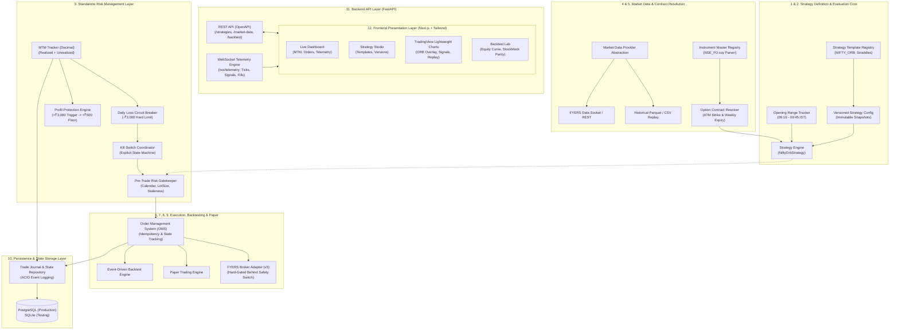

# System Architecture Specification: MyTradeView Quantitative Trading Workstation

## 1. Executive Summary & Product Vision

`MyTradeView` is an institutional-grade, configuration-driven quantitative algorithmic trading workstation tailored for automated and backtested derivatives strategies on the National Stock Exchange of India (NSE). It interfaces directly with the FYERS brokerage platform via FYERS API v3 and supports offline research via historical market datasets.

### The Product Vision: Workstation vs. Hardcoded Bot
This application is **not** a single hardcoded NIFTY breakout script. It is architected as an extensible trading workstation providing:
1. **Strategy Template System:** Multi-strategy support using validated, typed templates (with NIFTY ORB as the primary validated template).
2. **Immutable Versioning:** Strategy configurations are versioned snapshots tied deterministically to backtests and trading sessions.
3. **Discrete Risk Containment:** Standalone MTM tracking, hard loss circuit breakers (-₹3,000), profit protection (+₹3,000 trigger / +₹500 floor), and centralized pre-trade gatekeeping independent of strategy logic.
4. **Interactive Visualization:** Next.js + Tailwind CSS frontend featuring TradingView Lightweight Charts with custom opening range and signal overlays.
5. **Decoupled Execution Pipelines:** Deterministic event replay for historical backtesting, simulated order matching for paper trading, and gated broker execution for live deployment.

---

## 2. Core Architectural Principles

1. **Safety-First Fail-Closed Interlocks:** Execution mode defaults to **`PAPER`** (`simulation`/`paper`). Live trading is physically disabled and requires explicit dual-flag server authorization (`LIVE_TRADING_ACK=true`) plus pre-flight verification.
2. **Fixed-Precision Financial Calculations:** All prices, strikes, quantities, P&L, and MTM calculations use Python `Decimal` with explicit arithmetic rounding (`ROUND_HALF_UP`), eliminating binary floating-point rounding errors.
3. **Template-Based Strategy Modularity:** Strategies are declared as configuration-driven parameter sets evaluated against standard strategy templates, allowing future additions (e.g. Intraday Straddles, Momentum) without code rewrites.
4. **Decoupled Tier-1 and Tier-2 Risk Gates:** Risk rules operate independently of strategy signal generation. Pre-trade orders are audited by a central gatekeeper, while in-trade positions are monitored by standalone MTM trackers and kill switches.
5. **Two-Phase Atomic Reversal Sequencing:** Physical prevention of simultaneous opposing option positions or naked double-exposure: **Close Existing Position $\to$ Confirm Fill $\to$ Open Replacement Position**.
6. **Zero Broker Secret Check-in:** FYERS developer credentials and OAuth tokens reside strictly in secure local environments (`./secrets/`) and are never dispatched to frontend web clients.

---

## 3. High-Level Workstation Architecture

---

## 4. The 12 Target Architectural Subsystems

### Subsystem 1: Strategy Definitions & Configuration
- **Package:** `src/core/strategy_template.py`, `config/strategy_config.py`
- **Responsibilities:**
  - Manages `StrategyTemplate` registry defining supported assets, parameters, and schemas.
  - Implements `VersionedStrategyConfig` ensuring all parameters are typed, validated, and immutable during runtime.
  - Generates parameter diffs and validates against unconfirmed or unsupported parameters.

### Subsystem 2: Strategy Evaluation
- **Package:** `src/strategy/`
- **Responsibilities:**
  - Evaluates discrete market events (candles or ticks) against configured strategy rules.
  - `OpeningRangeTracker`: Manages 09:16 to 09:45 IST boundary calculations and freezing.
  - `NiftyOrbStrategy`: Implements StockMock-faithful entry signals, two-phase reversal sequencing, and mandatory square-off.

### Subsystem 3: Risk Management
- **Package:** `src/risk/`
- **Responsibilities:**
  - `MtmTracker`: Standalone mark-to-market accounting with explicit staleness and data-quality checks.
  - `DailyLossCircuitBreaker`: Enforces -₹3,000 threshold and manages session lockout.
  - `ProfitProtectionEngine`: Manages +₹3,000 profit trigger and dynamic trailing floors.
  - `PreTradeGatekeeper`: 12-point deterministic validation before orders reach execution adapters.
  - `KillSwitchCoordinator`: Explicit state machine managing emergency cancellations and liquidations.

### Subsystem 4: Market Data
- **Package:** `src/data/base.py`, `src/data/offline_provider.py`, `src/data/fyers_adapter.py`
- **Responsibilities:**
  - Abstract `MarketDataProvider` interface serving underlying and option candles.
  - Offline historical provider with strict validation (gap detection, chronological replay, no fabrication).
  - High-speed in-memory LRU/TTL market data cache.

### Subsystem 5: Contract Resolution
- **Package:** `src/data/contract_resolver.py`, `src/data/instrument_master.py`
- **Responsibilities:**
  - Ingests and normalizes official FYERS `NSE_FO.csv` derivative master files.
  - Calculates ATM strikes via arithmetic `ROUND_HALF_UP` on 50-point intervals.
  - Resolves holiday-adjusted weekly expiries and extracts dynamic lot sizes.

### Subsystem 6: Order Execution & Management (OMS)
- **Package:** `src/oms/`
- **Responsibilities:**
  - Manages order lifecycle through validated state transitions (`NEW` $\to$ `TRANSIT` $\to$ `PENDING` $\to$ `FILLED`).
  - Enforces client order tag idempotency and atomic fill tracking.

### Subsystem 7: Backtesting Lab
- **Package:** `src/backtest/`
- **Responsibilities:**
  - Discrete-event historical simulation replaying 1-minute data streams.
  - Accounts for realistic execution slippage and brokerage charges.
  - Evaluates performance metrics (Sharpe, Drawdown, Profit Factor, Win Rate).

### Subsystem 8: Paper Trading
- **Package:** `src/scheduler/` (Paper Mode)
- **Responsibilities:**
  - Executes strategies against real-time market data without financial risk.
  - Simulates realistic order fills using top-of-book market prices.

### Subsystem 9: Live Broker Execution
- **Package:** `src/broker/`
- **Responsibilities:**
  - Connects to FYERS API v3 REST and WebSocket endpoints.
  - Manages OAuth 2.0 token caching and reconciliation polling.
  - Hard-locked by safety interlocks during development phases.

### Subsystem 10: Persistence & Reporting
- **Package:** `src/storage/`
- **Responsibilities:**
  - PostgreSQL / SQLite storage via SQLAlchemy 2.0.
  - Stores versioned configs, trading sessions, orders, fills, positions, risk snapshots, and audit events.

### Subsystem 11: Backend APIs
- **Package:** `src/api/` (Documented in `API_CONTRACTS.md`)
- **Responsibilities:**
  - REST endpoints for workstation configuration, backtest execution, and history queries.
  - WebSocket telemetry broadcasting ticks, signals, order updates, and risk alerts.

### Subsystem 12: Frontend Presentation
- **Package:** `frontend/` (Documented in `FRONTEND_IMPLEMENTATION_PLAN.md`)
- **Responsibilities:**
  - Next.js 14+ application providing Dashboard, Strategy Builder, Interactive Charts, Backtesting Lab, and Paper Terminal.
  - TradingView Lightweight Charts integration for low-latency visual analytics.
