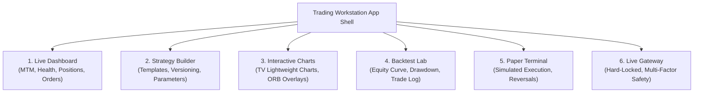

# Frontend Implementation Plan: MyTradeView Trading Workstation

## 1. Executive Summary & Technology Stack

The `MyTradeView` frontend transforms the automated algorithmic trading engine into an institutional-grade, configuration-driven quantitative workstation. 

### Core Technology Decisions
- **Framework:** **Next.js 14+ (App Router)** with **TypeScript 5+** for strict type-safety and server-side rendering of initial market metadata.
- **Styling & Design System:** **Tailwind CSS** paired with **Shadcn UI (Radix UI)** for a high-density, dark-themed terminal aesthetic (optimized for low-latency visual clarity).
- **Charting Engine:** **TradingView Lightweight Charts (v4.x)** — evaluated and chosen for superior canvas rendering performance, 60fps high-frequency tick updates, and seamless custom candlestick, area, and marker overlays.
- **Client State & Server Cache:** **TanStack Query (React Query v5)** for optimistic UI updates, polling fallbacks, and query deduplication; **Zustand** for transient UI state (selected strategy, chart crosshairs, active replay timestamps).
- **Real-Time Communication:** **Native WebSocket API** with auto-reconnecting client manager handling duplex telemetry (ticks, order states, risk triggers).

### Core Architectural Principle: Zero Client-Side Trading Logic
The frontend is strictly a visualization and command-dispatch surface. It does **not** evaluate breakouts, calculate MTM, determine strike selection, or directly communicate with FYERS APIs. All financial calculations occur on the backend Python engine with `Decimal` fixed precision. Broker credentials are never transmitted to or stored within the browser.

---

## 2. Workstation Navigation & Information Architecture



---

## 3. Detailed View Specifications

### 3.1 Live Dashboard (`/dashboard`)
The central command console for active market operations.

- **Header Telemetry Bar:**
  - Market Session Status: Pre-Market, ORB Formation, Active Trading, Square-Off, Closed.
  - FYERS Data Feed Health: Latency (ms), WebSockets connected/disconnected, Token TTL.
  - Active Strategy Sessions: Tagged with strategy name, version, and execution mode (`PAPER`).
- **Key Metrics Strip (Real-Time Cards):**
  - **Net Day P&L:** Large format currency display, colored by sign (`+₹3,250.00` green / `-₹1,200.00` red).
  - **Realized P&L:** Closed trade gains/losses.
  - **Unrealized P&L:** Real-time MTM of active options legs.
  - **Peak MTM & Drawdown:** Gauge component visualizing current drawdown vs. max tolerated drawdown.
  - **Risk Circuit Breaker Status:** Pill badge (`NORMAL`, `TRIGGERED`, `LOCKED_OUT_FOR_DAY`).
- **Active Positions Table:**
  - Symbol, Side (Long/Short), Net Qty, Lots, Average Buy Price, Live LTP (with green/red flash animations), Unrealized P&L, Actions (`Square Off Position`).
- **Active Orders & Execution State Table:**
  - Time, Client Order ID, Broker Order ID, Symbol, Side (BUY/SELL), Qty, Status Badge (`NEW`, `TRANSIT`, `PENDING`, `FILLED`, `CANCELLED`, `REJECTED`), Fill Price, Tag.
- **Audit & Risk Events Stream:**
  - Real-time event log streaming pre-trade validations, fills, trailing floor advancements, and circuit breaker events.

---

### 3.2 Strategy Builder & Versioning Studio (`/strategies`)
Enables template-based creation, editing, and versioning of strategies without touching code.

- **Strategy Template Selector:**
  - Card gallery featuring supported templates:
    1. **NIFTY Opening Range Breakout (ORB)** (Primary supported template).
    2. *Intraday Short Straddle / Strangle* (Roadmap template).
    3. *Momentum Breakout* (Roadmap template).
- **Dynamic Configuration Form:**
  - Auto-generated forms based on the template's `StrategyParameterDefinition` schema.
  - **NIFTY ORB Parameters:**
    - Underlying index (`NSE:NIFTY50-INDEX`).
    - ORB Start Time (`09:16:00 IST`) and End Time (`09:45:00 IST`).
    - Mandatory Exit Time (`15:10:00 IST`).
    - Trading Days multi-select checkboxes (`Monday`, `Thursday`, `Friday`).
    - Position Sizing (Lots: `1`, Lot size dynamically verified).
    - Breakout Confirmation Mode radio buttons: `Candle Close (1-min)` vs. `Intrabar Tick`.
    - Range Boundary Mode radio buttons: `09:16 to 09:44 Close (Ends 09:45)` vs. `09:16 to 09:45 Close (Ends 09:46)`.
    - Daily Loss Limit: Number input (`3000.00` INR).
    - Profit-Protection Trigger (`3000.00` INR), Min Lock (`500.00` INR), Trailing Step Profit (`1000.00` INR), Trailing Step Lock (`500.00` INR).
- **Version History & Diff Viewer:**
  - Timeline of saved versions (`v1`, `v2`, `v3`).
  - Side-by-side JSON/Parameter diff highlighting modified risk thresholds or timing parameters.
  - Action buttons: `Save New Version`, `Set Active`, `Launch Backtest`, `Deploy to Paper`.

---

### 3.3 Interactive Candlestick Charts (`/charts`)
Built using **TradingView Lightweight Charts** for institutional charting capability.

- **Chart Visual Hierarchy:**
  - **Candlestick Series:** 1-minute OHLC bars for underlying NIFTY 50 Index.
  - **Distinct Options Candlestick Panel:** Separate synced sub-chart or overlay toggle for active option contract (`NSE:NIFTY...CE/PE`), preventing confusion between index spot and derivative premiums.
  - **Opening Range Overlays:**
    - Semi-transparent horizontal channel marking `OR_HIGH` and `OR_LOW`.
    - Shaded background vertical band spanning the formation window (09:16:00 to 09:45:00 IST).
    - Color coding: Cyan upper boundary, Magenta lower boundary.
  - **Strategy Event Markers:**
    - Green upward arrow (`▲`) at bar time: `ENTER_LONG_CE` breakout signal.
    - Red downward arrow (`▼`) at bar time: `ENTER_LONG_PE` breakout signal.
    - Amber circular marker (`●`): Two-phase atomic reversal trigger (`CLOSE_CE` / `CLOSE_PE`).
    - Purple flag marker (`⚑`): Mandatory 15:10 IST square-off.
    - Dark red cross (`✖`): Kill-switch emergency liquidation.
  - **Visual Distinction for Execution Types:**
    - *Signal Generated:* Dashed marker border.
    - *Paper / Simulated Fill:* Solid filled marker.
    - *Broker Confirmed Fill:* Dual ring marker with tooltip showing execution slippage.
- **Controls & Tools:**
  - Crosshair with HUD displaying OHLC, Range High/Low, and Distance to Breakout.
  - Zoom, Pan, Timeframe picker (1m, 3m, 5m, 15m), and Reset View.
  - Historical Replay Mode: Scrub slider allowing bar-by-bar chronological playback with synchronized strategy state.

---

### 3.4 Backtesting Lab (`/backtest`)
Comprehensive historical simulation analysis and StockMock validation.

- **Configuration Setup Bar:**
  - Strategy selector (bound to specific `config_id` and `version`).
  - Date range picker with quick presets (Last 30 Days, YTD, Full Year 2026, Custom).
  - Dataset selector: Validates whether 1-minute option contracts are present or spot-only index candles (disabling options backtesting if expired options data is unavailable).
  - Cost & Slippage model: Fixed points per trade (`0.50`, `1.00`) and broker transaction charges.
- **Performance Analytics Dashboard:**
  - **Equity Curve:** Interactive line chart showing cumulative portfolio P&L over time.
  - **Underwater Drawdown Chart:** Area chart illustrating drawdown depth and recovery duration.
  - **Summary Metric Cards:**
    - Net P&L (INR & %).
    - Profit Factor ($ \text{Gross Profits} / \text{Gross Losses} $).
    - Win Rate (%) & Total Trades count.
    - Max Drawdown (INR & Peak-to-Trough %).
    - Average Win vs. Average Loss ratio.
    - Longest Consecutive Winning / Losing streaks.
    - Daily Loss Limit Hit Count.
    - Profit-Protection Triggered Count.
- **Trade Journal Table:**
  - Expandable row per trade showing: Date, Day of Week, Leg Type (CE/PE), Entry Time & Price, Exit Time & Price, Reversal Indicator, Duration, Realized P&L, Slippage Incurred, and Exit Reason.
- **StockMock Benchmark Parity Tab:**
  - CSV upload dropzone for StockMock export CSVs.
  - Automated diff highlighter matching trade-by-trade entry times, strikes, and P&L.

---

### 3.5 Paper Trading Terminal (`/paper`)
Simulated execution environment using live market feeds.

- Real-time simulation console receiving live ticks from backend WebSocket.
- Simulated OMS order book showing instant fill simulation based on top-of-book bid/ask.
- Real-time order state transition tracker (`NEW` $\to$ `TRANSIT` $\to$ `PENDING` $\to$ `FILLED`).
- Manual Intervention Controls:
  - `Emergency Flatten All`: Manually triggers kill-switch coordinator.
  - `Pause Strategy`: Suspends new signal generation without closing open positions.

---

### 3.6 Live Trading Gateway (`/live`)
Future production execution console — hard-locked by safety interlocks during Phase 4.

- **Multi-Tier Safety Gate UI:**
  - Locked banner: *"Live Trading is disabled in application configuration (`EXECUTION_MODE=paper`)."*
  - Multi-Factor Activation Flow: Requires both server environment variable `LIVE_TRADING_ACK=true` and explicit client authorization.
- **Broker Connectivity & RMS Monitor:**
  - FYERS account funds, margin utilized, and available intraday limit.
  - Real-time broker order reconciliation status (detecting any out-of-sync positions).
  - Physical Emergency Kill-Switch: Prominent red button initiating unconditional REST `/api/v3/positions` cancellation.

---

## 4. Component Hierarchy & File Structure

```text
frontend/
├── src/
│   ├── app/
│   │   ├── layout.tsx                 # Root layout with sidebar & telemetry header
│   │   ├── page.tsx                   # Redirect to /dashboard
│   │   ├── dashboard/page.tsx         # Live dashboard view
│   │   ├── strategies/page.tsx        # Strategy builder & versioning studio
│   │   ├── charts/page.tsx            # TradingView Lightweight Charts studio
│   │   ├── backtest/page.tsx          # Backtesting analysis lab
│   │   ├── paper/page.tsx             # Paper trading terminal
│   │   └── live/page.tsx              # Live execution gateway (disabled)
│   ├── components/
│   │   ├── charts/
│   │   │   ├── CandlestickChart.tsx   # TV Lightweight Charts wrapper
│   │   │   ├── OpeningRangeOverlay.ts # Custom TV canvas plugin for ORB zones
│   │   │   ├── SignalMarkers.ts       # Trade & signal marker layer
│   │   │   └── ReplayControls.tsx     # Historical replay scrubber
│   │   ├── dashboard/
│   │   │   ├── MetricCard.tsx         # Real-time P&L / drawdown card
│   │   │   ├── PositionsTable.tsx     # Active positions list
│   │   │   ├── OrdersTable.tsx        # Working & completed orders
│   │   │   └── RiskStatusBanner.tsx   # Kill-switch & circuit breaker alert
│   │   ├── strategies/
│   │   │   ├── TemplateSelector.tsx   # Strategy template picker
│   │   │   ├── OrbParameterForm.tsx   # NIFTY ORB parameter form
│   │   │   └── VersionHistory.tsx     # Version diff viewer
│   │   └── ui/                        # Shadcn UI primitives (button, dialog, table, badge)
│   ├── hooks/
│   │   ├── useWebSocket.ts            # Duplex WebSocket hook with auto-reconnect
│   │   ├── useMarketData.ts           # TanStack Query hook for historical candles
│   │   ├── useStrategyState.ts        # Live strategy session subscription
│   │   └── useRiskSnapshot.ts         # Real-time MTM and risk metrics
│   ├── lib/
│   │   ├── api.ts                     # REST client for backend FastAPI endpoints
│   │   ├── constants.ts               # Enumerations and default parameters
│   │   └── formatters.ts              # INR currency and IST time formatters
│   └── types/
│       ├── api.ts                     # TypeScript interfaces matching backend models
│       ├── strategy.ts                # Strategy parameter and template types
│       └── charts.ts                  # Candlestick and marker types
├── tailwind.config.js                 # Dark terminal palette configuration
├── tsconfig.json                      # Strict TypeScript settings
└── package.json                       # Dependencies (next, react, lightweight-charts, lucide-react)
```

---

## 5. Implementation Roadmap for Frontend Phase

1. **Step 1:** Scaffold Next.js 14 project, configure Tailwind CSS dark theme and Shadcn UI.
2. **Step 2:** Implement `CandlestickChart.tsx` with TradingView Lightweight Charts and custom ORB overlay shaders.
3. **Step 3:** Implement Strategy Builder form with schema-driven validation matching Python `StrategyTemplate`.
4. **Step 4:** Build WebSocket telemetry pipeline connecting to backend server for live ticks, P&L, and orders.
5. **Step 5:** Build Backtesting Lab with equity curve, drawdown charts, and StockMock CSV diff tool.
