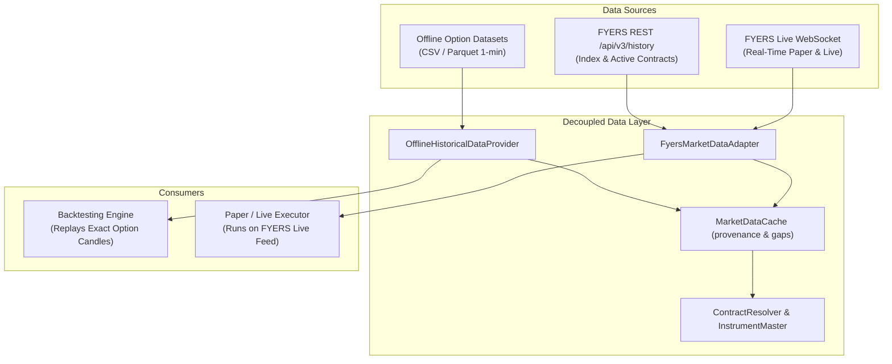

# Historical Market Data Feasibility Report: FYERS API v3 & Options Backtesting

**Author:** Quantitative Systems Engineering Team  
**System:** `MyTradeView` Automated Options Executor  
**Broker Interface:** FYERS API Version 3 (v3)  
**Date:** November 2, 2026  
**Status:** Completed Architectural Assessment  

---

## 1. Executive Summary

This feasibility report assesses the capabilities, endpoints, and constraints of **FYERS API v3** regarding historical market data for the **NIFTY Opening Range Breakout (ORB) Weekly Options Strategy**.

### Critical Engineering Finding:
> [!WARNING]
> **FYERS API v3 does NOT support historical intraday candle data for expired weekly options contracts.**  
> While FYERS provides extensive historical data for the **underlying index (`NSE:NIFTY50-INDEX`)** and **currently active (unexpired) contracts**, historical queries for expired weekly option symbols return empty or invalid symbol responses. 
> 
> Therefore, **FYERS API alone cannot be used to recreate multi-month or multi-year historical backtests of an option-buying strategy against StockMock.** Faithful options backtesting strictly requires historical 1-minute option price candles, which must be supplied via our offline historical data provider using validated CSV/Parquet datasets.

---

## 2. Official FYERS API v3 Historical Data Specifications

### 2.1 Verified Endpoints

| Endpoint | Method | Purpose | Verified Parameters |
| :--- | :--- | :--- | :--- |
| `/api/v3/history` | `GET` | Historical Candlesticks | `symbol`, `resolution`, `date_format`, `range_from`, `range_to`, `cont_flag` |
| `/api/v3/quotes` | `GET` | Real-time Market Quote | `symbols` (comma-separated exchange symbols) |
| `/api/v3/data/options-chain` | `GET` | Multi-strike Option Chain | `symbol` (e.g. `NSE:NIFTY50-INDEX`), `strikecount` |

### 2.2 Historical Request Parameters & Formats

* **`resolution` Options:**
  * Intraday Minutes: `"1"`, `"2"`, `"3"`, `"5"`, `"10"`, `"15"`, `"20"`, `"30"`, `"60"`, `"120"`, `"240"`
  * Daily: `"D"`
* **`date_format`:**
  * `"1"` = Epoch timestamp in seconds (Recommended: eliminates timezone parsing ambiguities).
  * `"0"` = String format (`yyyy-mm-dd`).
* **`range_from` & `range_to`:**
  * Start and end timestamps corresponding to chosen `date_format`.
* **`cont_flag`:**
  * `"1"` = Continuous futures data (stitched across expiries).
  * `"0"` = Non-continuous (Standard for cash indices and individual derivative contracts).

### 2.3 Verified Retrieval Limits & Constraints

1. **Maximum Date Range per Request:**
   * **1-Minute Resolution:** Maximum **100 days** per single API call. Queries spanning longer periods must be partitioned into sequential 100-day windows.
   * **Daily Resolution (`"D"`):** Up to **365 days** per call.
2. **API Rate Limits:**
   * Standard FYERS v3 REST limit: **10 requests per second** across historical endpoints.
   * Exceeding this returns HTTP `429 Too Many Requests`.
3. **Response Array Structure:**
   * Format: `[epoch_timestamp, open, high, low, close, volume]`
   * Response envelope: `{"s": "ok", "candles": [...]}`

---

## 3. Current vs. Expired Options Data Capabilities

### 3.1 Underlying Index Data (`NSE:NIFTY50-INDEX`)
* **Capability:** **Full Historical Support.**
* **Coverage:** Multiple years of historical 1-minute candles are accessible via `/api/v3/history`.
* **Utility:** Sufficient to establish historical Opening Range High (`OR_HIGH`) and Low (`OR_LOW`) between 09:16 and 09:45 IST, and to detect historical breakout timestamps.

### 3.2 Active (Unexpired) Option Contracts
* **Capability:** **Supported.**
* **Coverage:** Intraday 1-minute data is available from contract listing date up to the current session.
* **Utility:** Supported for paper trading, forward simulation, and intra-week trend analysis.

### 3.3 Expired Option Contracts
* **Capability:** **UNSUPPORTED on FYERS API v3.**
* **Mechanism:** Upon contract expiration (typically Thursday 15:30 IST), weekly option contracts are delisted from FYERS active symbology. Subsequent requests to `/api/v3/history` using the expired trading symbol (e.g. `NSE:NIFTY24OCT24500CE`) return:
  ```json
  {
    "s": "error",
    "code": -100,
    "message": "Record not found / Symbol does not exist"
  }
  ```
* **Continuous Option Series:** FYERS supports `cont_flag=1` only for **Futures**, not for options. There is no concept of continuous ATM option data on FYERS.

---

## 4. Quantitative Analysis: Why Index Candles Alone Cannot Backtest Options

A common amateur fallacy in algorithmic trading is backtesting an option strategy by assuming a synthetic fixed option price or calculating option P&L purely from index delta (e.g. $\Delta \text{PnL} \approx \text{Index Move} \times 0.5$). 

In institutional quantitative engineering, this is strictly rejected because:

1. **Theta Decay (Time Value):** Intraday option premium decays non-linearly, particularly on **Thursday (0 DTE expiry sessions)** where theta accelerates rapidly in the afternoon.
2. **Implied Volatility (IV) Crushes / Spikes:** On high-impact news or RBI/budget sessions, index movement may not translate to call option profit if IV collapses.
3. **Bid-Ask Spread & Liquidity Slippage:** Weekly ATM options trade with dynamic spreads (typically ₹0.50 to ₹3.00) that directly erode 1-lot profitability.
4. **StockMock Parity:** StockMock evaluates strategies using actual 1-minute trade/tick records of the specific historical option strike.

**Conclusion:** To achieve numerical parity with StockMock, the backtesting engine must ingest historical 1-minute OHLCV candles of the specific ATM option contracts traded on those historical dates.

---

## 5. Architectural Solutions & Strategic Roadmap

To guarantee deterministic, faithful strategy execution without violating data integrity, the system implements a three-tier data architecture:



### Path 1: Offline Historical Datasets (Approved for Phase 2 & Phase 5)
* Ingest verified historical 1-minute CSV or Parquet files containing historical NIFTY options and spot data.
* Our [`OfflineHistoricalDataProvider`](file:///c:/Users/Hashray_X/MyTradeView/src/data/offline_provider.py) parses, validates, and interleaves index and option candles into deterministic chronological streams.
* Zero subscription costs; completely reproducible offline.

### Path 2: Live Forward-Testing in PAPER Mode (Phase 6 through 9)
* Stream live ticks via FYERS Data Socket.
* Automatically record live 1-minute ATM option candles into PostgreSQL for every Monday, Thursday, and Friday session.
* Builds an organic, high-fidelity proprietary option dataset directly from the user's broker feed.

### Path 3: External Institutional Options Data Vendors (Optional - Requires User Consent)
* If extensive multi-year historical option backtests are required beyond available offline files, vendors like **TrueData** or **GlobalDataFeeds** provide historical 1-minute expired options data for Indian markets via API.
* *Policy:* No paid third-party data subscriptions will be initiated without explicit user review and written approval.
