# Implementation Plan: MyTradeView Quantitative Trading Workstation

## 1. Roadmap Overview & Strategic Objectives

This updated roadmap outlines the development path to transform `MyTradeView` from an automated NIFTY execution engine into a comprehensive **Configuration-Driven Quantitative Trading Workstation**.

### Core Commitments
- **Safety-First Fail-Closed Policy:** Live execution remains hard-disabled (`EXECUTION_MODE=paper`) with safety interlocks. No live broker orders are placed until all testing, paper simulations, and explicit user gates are satisfied.
- **Fidelity to Tested Strategy:** The primary supported template faithfully preserves the StockMock NIFTY ORB specification (09:16-09:45 IST, Mon/Thu/Fri, dynamic lot size, two-phase reversals, -₹3000 daily loss, +₹3000/+₹500 profit protection, 15:10 IST square-off).
- **Institutional Workstation Architecture:** Clean separation across the 12 target subsystems: Strategy Configuration, Strategy Evaluation, Risk Management, Market Data, Contract Resolution, Order Execution, Backtesting, Paper Trading, Live Broker Execution, Persistence, Backend APIs, and Next.js Frontend Presentation.

---

## 2. Phase-by-Phase Implementation Roadmap

```mermaid
flowchart LR
    P1["Phase 1: Foundations\n(Done)"] --> P2["Phase 2: Market Data\n(Done)"]
    P2 --> P3["Phase 3: Strategy Engine\n(Done)"]
    P3 --> P4["Phase 4: Risk & Templates\n(Done)"]
    P4 --> P5["Phase 5: Backtesting Lab\n(Next)"]
    P5 --> P6["Phase 6: OMS & Simulation"]
    P6 --> P7["Phase 7: FYERS Broker Adapter"]
    P7 --> P8["Phase 8: Session Scheduler"]
    P8 --> P9["Phase 9: FastAPI Backend"]
    P9 --> P10["Phase 10: Next.js Frontend"]
    P10 --> P11["Phase 11: Paper Validation"]
    P11 --> P12["Phase 12: Production Live Gate"]
```

---

### Phase 1: Core Domain Entities, Configuration & Database Foundations
- **Status:** **Completed & Verified** (Commits `dc321c4` & `f2db9a4`)
- **Key Deliverables:**
  - Strict Pydantic domain models with `Decimal` fixed-precision financial accounting.
  - Fail-closed configuration schemas with unconfirmed decision interlocks.
  - SQLAlchemy 2.0 schema (10 tables) supporting PostgreSQL and SQLite.
  - 30 unit tests covering precision arithmetic, models, configuration, and ACID persistence.

---

### Phase 2: Market Data Layer & Option Contract Resolver
- **Status:** **Completed & Verified** (Commit `24334fe`)
- **Key Deliverables:**
  - Abstract `MarketDataProvider` interface and historical offline CSV/Parquet provider.
  - FYERS `NSE_FO.csv` derivative master parser and `ContractResolver`.
  - Arithmetic `ROUND_HALF_UP` ATM strike calculation and holiday-adjusted expiry resolution.
  - Feasibility report (`HISTORICAL_DATA_FEASIBILITY.md`) detailing options data constraints.
  - 22 unit tests covering ingestion, caching, and contract lookups (52 total passing tests).

---

### Phase 3: Strategy Engine & Opening Range Logic
- **Status:** **Completed & Verified** (Commit `dc69c84`)
- **Key Deliverables:**
  - `OpeningRangeTracker`: Deterministic range builder with interval semantics (`UP_TO_0944_CLOSE` / `UP_TO_0945_CLOSE`).
  - `NiftyOrbStrategy`: Breakout entries, atomic two-phase reversal sequencing, idempotency guards, and 15:10 IST square-off.
  - Trading day filter (Mon, Thu, Fri active; Tue, Wed, Sat, Sun bypassed).
  - 13 unit tests covering breakouts, reversals, deduplication, and replay parity (65 total passing tests).

---

### Phase 4: Risk Management Engine, Configuration-Driven Architecture & Frontend Plan
- **Status:** **Completed & Verified** (Current Phase)
- **Key Deliverables:**
  - **Strategy Templates & Versioning:** `StrategyTemplate` registry and `VersionedStrategyConfig` ensuring strategies are configuration-driven rather than hardcoded.
  - **Standalone MTM Tracker (`src/risk/tracker.py`):** Fixed-precision accounting with zero double-counting, drawdown tracking, and staleness/invalid price detection.
  - **Daily Loss Circuit Breaker (`src/risk/circuit_breaker.py`):** -₹3,000 threshold enforcement with duplicate closure suppression and session lockout.
  - **Profit-Protection Engine (`src/risk/profit_protection.py`):** +₹3,000 trigger with +₹500 floor lock and dynamic step-based trailing.
  - **Pre-Trade Gatekeeper (`src/risk/pre_trade.py`):** 12-point deterministic validation before orders reach execution adapters.
  - **Kill-Switch Coordinator (`src/risk/kill_switch.py`):** Explicit state machine managing emergency cancellations and liquidations.
  - **Unified Facade (`src/risk/engine.py`):** Modular risk engine tying all components together.
  - **Frontend Plan (`FRONTEND_IMPLEMENTATION_PLAN.md`):** Complete Next.js + Tailwind + TradingView Lightweight Charts blueprint.
  - **API Contracts (`API_CONTRACTS.md`):** Complete REST OpenAPI and WebSocket telemetry specification.
  - **Test Suite:** 13 new unit tests (78 total passing tests in 2.79s).

---

### Phase 5: Discrete-Event Backtesting Engine & StockMock Benchmark Calibration
- **Objectives:**
  - Event-driven backtesting engine replaying 1-minute historical spot and option candles.
  - Portfolio accounting module supporting 1-lot entries, margin modeling, slippage, and transaction costs.
  - Comprehensive metrics calculator: Net P&L, Max Drawdown, Sharpe Ratio, Win Rate, Profit Factor, Expectancy.
  - StockMock comparison harness ingesting backtest trade CSV exports to verify trade-by-trade parity.

---

### Phase 6: Order Management System (OMS) & Execution Simulation Engine
- **Objectives:**
  - Stateful `OrderManager` tracking full lifecycle (`NEW` $\to$ `TRANSIT` $\to$ `PENDING` $\to$ `FILLED`).
  - Simulated execution adapter with realistic fill models (bid/ask matching, spread simulation, slippage).
  - Client order tag generation and persistent state reconciliation.

---

### Phase 7: FYERS API v3 Broker Adapter & WebSocket Integration
- **Objectives:**
  - Concrete FYERS broker adapter wrapping REST endpoints (`/api/v3/orders`, `/api/v3/positions`, `/api/v3/quotes`).
  - Real-time `FyersDataSocket` and `FyersOrderSocket` with auto-reconnection and token refresh helpers.
  - Mock broker test harness simulating broker API responses and exchange reject codes.

---

### Phase 8: Scheduling, Market Session Lifecycle & Monitoring
- **Objectives:**
  - `SessionManager` orchestrating the daily lifecycle (Pre-market 09:00, ORB 09:16, Trading 09:45, Square-off 15:10, Close 15:30 IST).
  - Multi-channel alert dispatcher (Telegram, Slack, console).
  - Process heartbeat and system health monitor.

---

### Phase 9: Backend API Layer (FastAPI REST & WebSocket Telemetry)
- **Objectives:**
  - Implement REST endpoints specified in `API_CONTRACTS.md`.
  - Implement WebSocket telemetry broadcaster streaming live ticks, order updates, MTM snapshots, and risk events.

---

### Phase 10: Next.js Frontend Workstation & TradingView Lightweight Charts
- **Objectives:**
  - Scaffold Next.js 14 project following `FRONTEND_IMPLEMENTATION_PLAN.md`.
  - Build TradingView Lightweight Charts component with custom ORB overlay shaders and signal markers.
  - Implement Dashboard, Strategy Builder, Backtesting Lab, and Paper Trading views.

---

### Phase 11: Comprehensive Paper Trading Validation
- **Objectives:**
  - Multi-day live paper trading run using real-time FYERS data sockets and simulated order fills.
  - Verification of zero duplicate orders, zero crashes, and exact risk enforcement under volatile market conditions.

---

### Phase 12: Production Readiness & Live Trading Gate
- **Objectives:**
  - Pre-flight compliance checklist.
  - Production PostgreSQL database deployment.
  - Explicit multi-factor authorization gate for live broker execution.
