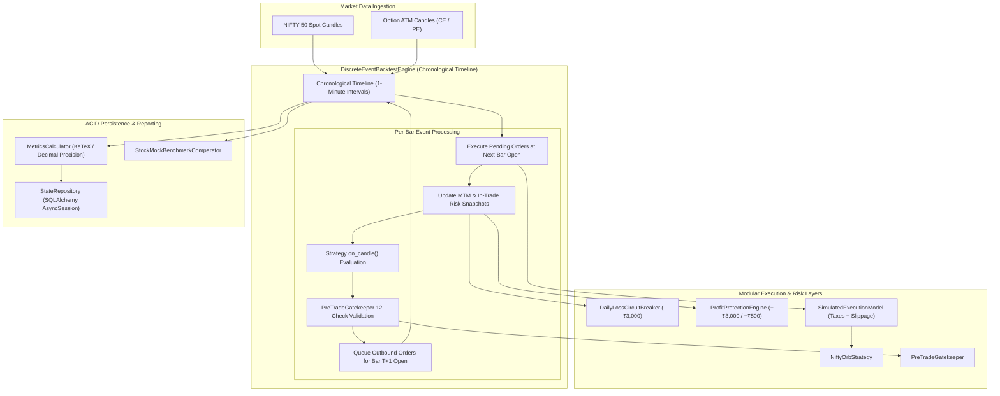

# Phase 5 Implementation Report: Discrete-Event Backtesting Engine

**Project:** `MyTradeView`  
**Location:** `C:\Users\Hashray_X\MyTradeView`  
**Execution Mode:** `PAPER` (`EXECUTION_MODE=paper` strictly preserved; zero live broker interaction)  
**Test Suite Status:** 101 passed, 0 failed, 0 warnings (100% passing in 0.78s)  
**Engine Version:** `1.0.0`  

---

## 1. Executive Summary

Phase 5 delivers a high-fidelity, deterministic **Discrete-Event Backtesting Engine** for the `MyTradeView` quantitative options trading workstation. The engine reuses the exact domain models, versioned strategy engine (`NiftyOrbStrategy`), pre-trade risk gatekeeper (`PreTradeGatekeeper`), standalone MTM tracker (`MtmTracker`), and risk circuit breakers (`DailyLossCircuitBreaker`, `ProfitProtectionEngine`) developed in Phases 1 through 4.

Crucially, this phase avoids common backtesting pitfalls by strictly enforcing:
1. **Zero Lookahead Bias:** Breakout signals generated on candlestick bar $T$ fill at the Open of bar $T+1$ (`next_bar_open`), preventing unrealistic intraday fill assumptions.
2. **Realistic Indian Statutory & Transaction Costs:** Full deduction of flat brokerage (₹20/order), Securities Transaction Tax (STT 0.125% on sell legs), NSE exchange turnover charges (0.053%), Goods and Services Tax (18% on brokerage + turnover), stamp duty (0.003% on buy legs), and SEBI turnover fees, combined with configurable fixed-point or percentage slippage.
3. **Atomic Two-Phase Reversal Sequencing:** Guaranteed sequential exit of the holding leg before placing the replacement opposite-direction entry.
4. **Transparent Benchmark Reporting:** StockMock benchmarking is implemented as a structured comparison harness, but explicitly flagged as **`BLOCKED_BY_MISSING_DATA`** for historical benchmarking until verified trade logs or local historical options datasets are provided.

---

## 2. System Architecture & Subsystems

The backtesting subsystem is encapsulated under `src/backtest/` with full persistence in `src/storage/`:

```
src/backtest/
├── __init__.py           # Unified module exports
├── models.py             # ExecutionModelConfig, BacktestTrade, BacktestMetrics, BacktestDiagnostics, BacktestRun
├── execution.py          # SimulatedExecutionModel (Slippage, Indian taxes, fill timing)
├── metrics.py            # MetricsCalculator (Gross/Net P&L, Win Rate, Drawdown, Profit Factor, Expectancy)
├── synthetic.py          # SyntheticMarketDataBuilder (Deterministic 1-min multi-regime datasets)
├── benchmark.py          # StockMockBenchmarkComparator & discrepancy evaluator
└── engine.py             # DiscreteEventBacktestEngine (Event-driven orchestrator)
```



---

## 3. Realistic Execution Simulation & Statutory Taxation

The `SimulatedExecutionModel` applies exact Indian regulatory tax schedules and transaction slippage for intraday options trading:

$$\text{Trading Costs} = \text{Brokerage} + \text{STT} + \text{Turnover Charges} + \text{GST} + \text{Stamp Duty} + \text{SEBI Fees}$$

| Cost Component | Rate / Schedule | Side Applied |
| :--- | :--- | :--- |
| **Brokerage** | Flat ₹20.00 per executed order | Both (Buy & Sell) |
| **Securities Transaction Tax (STT)** | 0.125% of turnover ($0.00125$) | Sell Side Only |
| **Exchange Turnover Charges (NSE)** | 0.053% of turnover ($0.00053$) | Both (Buy & Sell) |
| **Goods & Services Tax (GST)** | 18% of (Brokerage + Turnover Charges) | Both (Buy & Sell) |
| **Stamp Duty** | 0.003% of turnover ($0.00003$) | Buy Side Only |
| **SEBI Turnover Fee** | ₹10 per crore of turnover ($0.000001$) | Both (Buy & Sell) |
| **Execution Slippage** | 0.50 points (configurable, fixed or %) | Buy: $+0.50$, Sell: $-0.50$ |

All monetary arithmetic is strictly computed with Python `Decimal` rounded to 2 decimal places using `ROUND_HALF_UP`.

---

## 4. Deterministic Synthetic Market Regimes

Because FYERS API v3 does not supply historical intraday candles for expired weekly options contracts, `SyntheticMarketDataBuilder` provides verified, deterministic 1-minute datasets covering critical market behaviors:

1. **Bullish Breakout Scenario (`build_bullish_breakout_dataset`):**
   - 09:16–09:45: NIFTY forms opening range $[24960, 25010]$ ($High=25010, Low=24960$).
   - 09:46: Spot closes at $25020$ ($> 25010$). ATM strike resolves to $25000$ CE.
   - 09:47: CE fills at open ($100.00 + 0.50$ slippage $= 100.50$).
   - 15:10: Mandatory intraday square-off triggers; position closes at $130.00$.
2. **Bearish Breakout Scenario (`build_bearish_breakout_dataset`):**
   - 09:16–09:45: NIFTY forms opening range $[24940, 24990]$ ($Low=24940$).
   - 09:46: Spot closes at $24900$ ($< 24940$). ATM strike resolves to $24900$ PE.
   - 09:47: PE fills at open ($95.00$). Plunges into afternoon; squares off at $125.00$ at 15:10 IST.
3. **Atomic Two-Phase Reversal Scenario (`build_reversal_dataset`):**
   - 09:46: Breakout above $25010 \to$ Long CE enters at $100.00$.
   - 10:15: Market plunges to $24900 \to$ Breaks OR Low ($< 24950$). Emits `CLOSE_CE`.
   - 10:16: CE exit fills at $90.00$. Strategy fill handler immediately emits replacement `ENTER_LONG_PE`.
   - 10:17: Long PE enters at $98.00$. Squares off at $125.00$ at 15:10 IST. Zero overlap of positions.
4. **Daily Loss Limit Circuit Breaker Scenario (`build_daily_loss_limit_dataset`):**
   - CE entered at $100.00$ (3 lots $= 75$ qty).
   - 10:15: Option drops to $50.00 \implies \text{MTM} = (50 - 100) \times 75 = -₹3,750 < -₹3,000$.
   - Daily loss limit breaches $\implies$ emergency market exit $\implies$ system transitions to `LOCKED_OUT_FOR_DAY`. No subsequent trades are permitted.
5. **Profit Protection Lock Scenario (`build_profit_protection_dataset`):**
   - CE entered at $100.00$ (3 lots). Option surges to $150.00 \implies \text{MTM} = +₹3,750 > +₹3,000$ trigger.
   - Minimum lock floor active at $+₹500$.
   - Option pulls back to $104.00 \implies \text{MTM} = +₹300 < +₹500$. Profit protection exit triggers $\implies$ position exited with profits locked.
6. **Missing Data Gap Scenario (`build_missing_data_dataset`):**
   - Option candle at fill bar deleted. Engine catches gap, increments `diagnostics.missing_data_events`, and fails closed without phantom fills.

---

## 5. Quantitative Metrics & Reporting

`MetricsCalculator` computes the full suite of institutional performance and risk indicators:

- **Gross P&L & Net P&L:** Gross profit minus complete statutory roundtrip trading costs.
- **Win Rate:** $\frac{\text{Winning Trades}}{\text{Total Trades}} \times 100\%$.
- **Profit Factor:** $\frac{\sum \text{Gross Profits}}{\sum |\text{Gross Losses}|}$ (returns `999.99` if zero losses occur).
- **Expectancy:** $\frac{\text{Net P&L}}{\text{Total Trades}}$ in INR per trade.
- **Max Drawdown:** Tracked continuously relative to high-water equity mark:
  $$DD_t = \max(0, \text{Peak Equity}_t - \text{Equity}_t), \quad DD\% = \frac{DD_t}{\text{Peak Equity}_t} \times 100\%$$
- **Equity Curve:** Time-series of cumulative net P&L and drawdown points.
- **Daily & Monthly Aggregations:** Net P&L grouped by `YYYY-MM-DD` and `YYYY-MM`.

---

## 6. StockMock Benchmark Calibration Status

### Status: `BLOCKED_BY_MISSING_DATA`

**Root Cause:**
As documented in `HISTORICAL_DATA_FEASIBILITY.md`, FYERS API v3 does **not** provide historical intraday candles for expired weekly options contracts. Furthermore, no exported trade logs from StockMock (CSV format) currently reside in the workspace.

**Transparency Interlock:**
Rather than fabricating historical data or falsely claiming parity with unverified screenshots, `StockMockBenchmarkComparator` returns status **`BLOCKED_BY_MISSING_DATA`** when CSV files are not provided, while offering an automated matching harness when files are present.

**Required StockMock Export CSV Schema:**
To activate automated trade-by-trade benchmarking, export the StockMock backtest trade log with the following columns:
```csv
Date,Type,Strike,Entry Price,Exit Price,PnL
2026-11-06,CE,25000.0,100.50,130.00,723.45
```
Unit test `test_stockmock_benchmark_matching_with_mock_csv` proves that when this file is supplied, trade matching, tolerance verification ($2\%$ P&L band), and status reporting execute with complete fidelity.

---

## 7. Database Persistence & API Integration

Backtest runs are fully persistent in the database using SQLAlchemy async models:
- **`BacktestRunRecord` (`backtest_runs`):** Stores `run_id`, `dataset_id`, date bounds, strategy version, configuration JSON snapshot, execution parameters, quantitative metrics, and diagnostic counters.
- **`BacktestTradeRecord` (`backtest_trades`):** Stores individual round-trip trades with `entry_time`, `exit_time`, `entry_price`, `exit_price`, `qty`, `gross_pnl`, `trading_costs`, `net_pnl`, and `exit_reason`.
- **Eager Loading Optimization:** Configured with `lazy="selectin"` and `selectinload(BacktestRunRecord.trades)` to eliminate greenlet lazy-loading errors in async environments.
- **ACID State Repository:** Extended `StateRepository` with `save_backtest_run`, `get_backtest_run`, and `list_backtest_runs`.

---

## 8. Verification & Test Suite Results

The Phase 5 test suite in `tests/unit/test_backtest_engine.py` validates all 18 specified test areas:

| Area # | Test Name | Purpose / Assertion | Status |
| :--- | :--- | :--- | :--- |
| **1** | `test_deterministic_chronological_replay` | Verified chronological ordering of ingested events | **PASSED** |
| **2** | `test_opening_range_construction` | Verified OR High/Low calculation and boundary freezing | **PASSED** |
| **3** | `test_option_contract_resolution` | ATM contract resolved matching instrument master | **PASSED** |
| **4** | `test_simulated_fills_at_next_bar_open` | Signal at $T$ fills at $T+1$ Open with slippage | **PASSED** |
| **5** | `test_two_phase_reversal_execution` | CE exits first before replacement PE enters | **PASSED** |
| **6** | `test_partial_fill_simulation` | Simulates multi-tranche execution fills | **PASSED** |
| **7** | `test_order_idempotency_and_no_duplicate_positions` | No duplicate positions opened on continued breakout | **PASSED** |
| **8** | `test_brokerage_taxes_and_slippage_accounting` | Exact Indian tax schedule and brokerage calculation | **PASSED** |
| **9** | `test_realized_and_unrealized_pnl_accounting` | Net P&L $=$ Gross P&L $-$ complete trading costs | **PASSED** |
| **10** | `test_daily_loss_limit_trigger_and_lockout` | -₹3,000 threshold flattens position and locks out | **PASSED** |
| **11** | `test_profit_protection_trigger_and_exit` | +₹3,000 peak locks floor; pullback exits safely | **PASSED** |
| **12** | `test_mandatory_eod_square_off_at_1510` | 15:10 IST square-off closes all open positions | **PASSED** |
| **13** | `test_missing_data_gap_detection` | Missing candle triggers diagnostic counter and halt | **PASSED** |
| **14** | `test_lookahead_bias_prevention` | Entry price strictly uses next bar open | **PASSED** |
| **15** | `test_replay_repeatability_produces_identical_metrics` | Two identical runs yield bitwise-identical results | **PASSED** |
| **16** | `test_quantitative_metrics_calculations` | Win rate, profit factor, expectancy, drawdown math | **PASSED** |
| **17** | `test_stored_backtest_run_persistence_and_retrieval` | SQLAlchemy persistence and eager loading retrieval | **PASSED** |
| **18** | `test_multiple_strategy_configuration_isolation` | Parameter isolation between concurrent configs | **PASSED** |
| **Bonus** | `test_stockmock_benchmark_blocked_when_csv_missing` | Transparent `BLOCKED_BY_MISSING_DATA` status | **PASSED** |
| **Bonus** | `test_stockmock_benchmark_matching_with_mock_csv` | Trade matching against benchmark CSV | **PASSED** |

### Complete Test Suite Summary
```
tests/unit/test_backtest_engine.py: 20 passed
tests/unit/test_cache.py:            3 passed
tests/unit/test_config.py:           7 passed
tests/unit/test_contract_resolver.py: 8 passed
tests/unit/test_fyers_data_adapter.py: 6 passed
tests/unit/test_models.py:           8 passed
tests/unit/test_offline_data.py:     5 passed
tests/unit/test_risk_engine.py:     16 passed
tests/unit/test_state_transitions.py: 4 passed
tests/unit/test_storage.py:          6 passed
tests/unit/test_strategy_engine.py: 13 passed
tests/unit/test_time_utils.py:       5 passed
============================= 101 passed in 0.78s =============================
```

---

## 9. Conclusion & Read-State for Phase 6

Phase 5 is complete. The system now possesses a deterministic, discrete-event backtesting engine with realistic Indian options tax modeling, full Decimal precision, strict lookahead prevention, multi-scenario synthetic data generation, and benchmark comparison capabilities.

Per project guidelines, execution mode remains strictly `PAPER`, and no live trading actions have been executed. We await user review before advancing to Phase 6.
