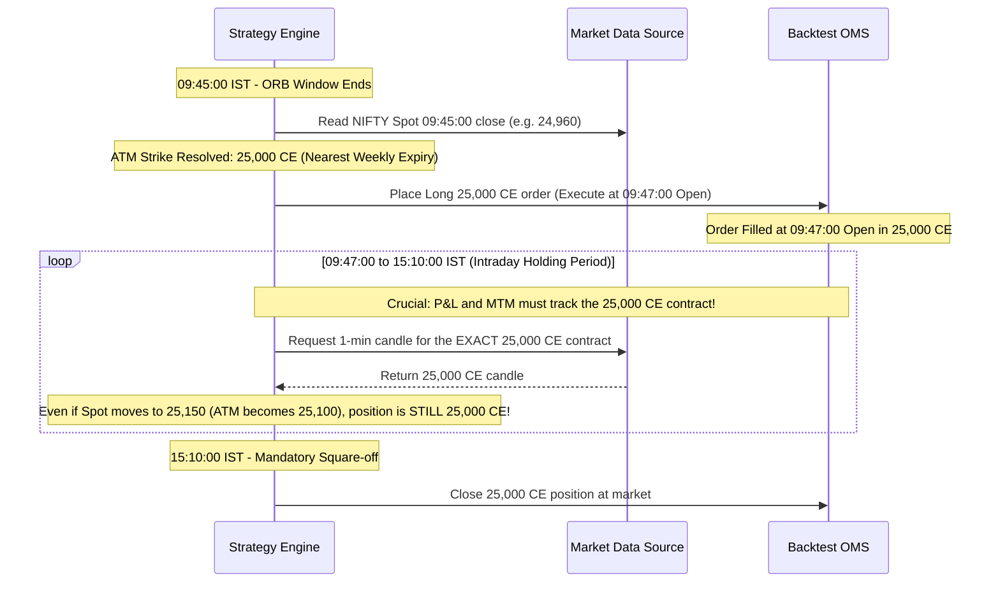

# Phase 7.4.1 Acceptance Report: Historical Option Data Source Verification

**Author:** Quantitative Systems Engineering Team  
**System:** `MyTradeView` Trading Workstation  
**Execution Mode:** `PAPER` Strictly Enforced  
**Date:** November 2, 2026  
**Final Status:** `BLOCKED — PROVIDER ACCESS OR DATA UNVERIFIED`  

---

## 1. Executive Summary & Objective

In `PHASE_7_4_HISTORICAL_DATA_FEASIBILITY.md`, two potential retail broker APIs were identified as candidate historical options sources: **DhanHQ API v2** (`/charts/rollingoption`) and **ICICI Direct Breeze API** (`breeze_connect`).

The objective of **Phase 7.4.1** is to perform an empirical acceptance audit on these candidates before committing engineering effort to ingestion pipeline implementation:
1. Verify official documentation and exact API request/response contracts.
2. Determine whether each provider can support **fixed-contract historical replay** (where the strategy enters a specific ATM strike at 09:47 IST and holds that identical contract until exit, without synthetic strike-switching).
3. Audit authentication requirements and check workspace credentials status.
4. Provide a secure, standalone test harness ([`scripts/test_historical_source_acceptance.py`](file:///C:/Users/Hashray_X/MyTradeView/scripts/test_historical_source_acceptance.py)) to test providers without exposing secrets.
5. Render a definitive verdict on whether live ingestion implementation can proceed.

---

## 2. Documentation Verification & API Contracts

### 2.1 DhanHQ API v2 (`/charts/rollingoption`)
* **Official Endpoint:** `POST https://api.dhan.co/v2/charts/rollingoption`
* **Official Documentation:** `https://dhanhq.co/docs/v2/`
* **Supported Intervals:** Intraday minutes (`1`, `5`, `15`, `25`, `60`).
* **Documented Coverage:** Up to **5 years** of rolling expired options data.
* **Request Parameters:**
  * `exchangeSegment`: `"NSE_FNO"`
  * `securityId`: Standard exchange ID of the underlying asset (`13` for NIFTY 50 index).
  * `instrument`: `"OPTIDX"` (Index Options) or `"OPTSTK"` (Stock Options).
  * `expiryFlag`: `"WEEK"` (Weekly) or `"MONTH"` (Monthly).
  * `expiryCode`: Expiry cycle sequence integer (`1` for nearest/active expiry, `2` for next expiry).
  * `strike`: Moneyness relative to spot: `"ATM"`, `"ATM+1"` to `"ATM+10"`, or `"ATM-1"` to `"ATM-10"`.
  * `drvOptionType`: `"CALL"` or `"PUT"`.
  * `requiredData`: Array of strings (`["open", "high", "low", "close", "volume", "oi", "iv", "spot"]`).
  * `fromDate` & `toDate`: Date strings (`YYYY-MM-DD`).
* **API Constraints & Rate Limits:**
  * Restricted to **1 day of 1-minute data per request**; multi-day backfills require serial day-by-day batching.
  * Standard rate limit: 10 requests per second.
* **Authentication:** Bearer token via `access-token: {JWT}` HTTP header.
* **Subscription Requirement:** Requires an active Dhan trading account with the **Data API subscription** enabled (₹499 + GST/month, ~₹589/mo).

```json
/* Sample Redacted Request Payload (DhanHQ) */
{
  "exchangeSegment": "NSE_FNO",
  "interval": "1",
  "securityId": 13,
  "instrument": "OPTIDX",
  "expiryFlag": "WEEK",
  "expiryCode": 1,
  "strike": "ATM",
  "drvOptionType": "CALL",
  "requiredData": ["open", "high", "low", "close", "volume"],
  "fromDate": "2024-10-24",
  "toDate": "2024-10-24"
}
```

```json
/* Sample Redacted Response Schema (DhanHQ) */
{
  "status": "success",
  "data": {
    "timestamp": [1729741500, 1729741560, 1729741620],
    "open": [142.50, 145.20, 144.00],
    "high": [146.00, 147.50, 145.50],
    "low": [141.00, 143.50, 142.80],
    "close": [145.00, 144.20, 145.10],
    "volume": [24500, 18200, 15400]
  }
}
```

---

### 2.2 ICICI Direct Breeze API (`breeze_connect`)
* **Official Interface:** Python SDK `BreezeConnect.get_historical_data` / `get_historical_data_v2`.
* **Official Documentation:** `https://api.icicidirect.com/` / PyPI `breeze-connect`.
* **Supported Intervals:** `1second`, `1minute`, `5minute`, `30minute`, `1day`.
* **Documented Coverage:** Up to **3 years** of historical expired F&O data.
* **Request Parameters:**
  * `stock_code`: `"NIFTY"`
  * `exchange_code`: `"NFO"`
  * `product_type`: `"options"`
  * `strike_price`: Explicit numerical strike (e.g. `24500`).
  * `right`: `"call"` or `"put"`.
  * `expiry_date`: ISO 8601 string of the contract expiration date (e.g. `"2024-10-24T07:00:00.000Z"`).
  * `from_date` & `to_date`: ISO 8601 query range strings.
  * `interval`: `"1minute"`.
* **API Constraints & Rate Limits:**
  * Rate limit: **100 requests per minute**.
  * Daily quota: **5,000 requests per day**.
* **Authentication:**
  * `api_key`: Application key from developer portal.
  * `api_secret`: Application secret key.
  * `session_token`: **Daily 2FA Session Key** generated each trading day via manual/browser login at `https://api.icicidirect.com/apiuser/login?api_key=...`. The session token strictly **expires daily at midnight**.
* **Subscription Requirement:** Free for users with an ICICI Direct trading account and active Breeze API access.

```python
# Sample Redacted Request (ICICI Direct Breeze)
breeze.get_historical_data(
    interval="1minute",
    from_date="2024-10-24T09:15:00.000Z",
    to_date="2024-10-24T15:30:00.000Z",
    stock_code="NIFTY",
    exchange_code="NFO",
    product_type="options",
    expiry_date="2024-10-24T07:00:00.000Z",
    right="call",
    strike_price=24500,
)
```

```json
/* Sample Redacted Response Schema (ICICI Direct Breeze) */
{
  "Success": [
    {
      "datetime": "2024-10-24 09:15:00",
      "open": 142.5,
      "high": 146.0,
      "low": 141.0,
      "close": 145.0,
      "volume": 24500,
      "open_interest": 452000
    }
  ],
  "Status": 200,
  "Error": null
}
```

---

## 3. Critical Requirement: Fixed-Contract Reconstruction

A realistic algorithmic backtest of the StockMock NIFTY ORB strategy requires a **fixed-contract execution model**:



### 3.1 DhanHQ `/charts/rollingoption` Evaluation

Our deep investigation of DhanHQ's documentation and response structure reveals an **insurmountable architectural limitation for fixed-contract backtesting**:

1. **Absence of Contract Identification:**
   * The response payload is purely columnar arrays: `timestamp`, `open`, `high`, `low`, `close`, `volume`.
   * **There is NO `strike`, `trading_symbol`, or `security_id` field in the response.**
2. **Dynamic Strike Rolling (Synthetic Basket):**
   * Dhan's `/charts/rollingoption` does **not** pin to a static strike price.
   * If a query specifies `"strike": "ATM"`, the API returns the candle of whatever strike happens to be ATM *at that specific minute*.
   * If NIFTY spot moves from 24,960 at 09:47 to 25,120 at 11:30, the data stream dynamically switches from 25,000 CE to 25,100 CE mid-session.
3. **Severe Contract-Switching Bias:**
   * If the strategy holds 25,000 CE, evaluating its P&L using Dhan's `"ATM"` stream would calculate MTM against the newly rolled 25,100 CE candle.
   * This completely invalidates position delta, gamma, and theta accounting, introducing massive synthetic distortion.
4. **No Direct Static Expired Query:**
   * Dhan does not support querying specific expired contracts by absolute strike or expired symbol via `/charts/historical`. Standard historical endpoints reject expired derivative tokens.

> [!CRITICAL]
> **Verdict on DhanHQ `/charts/rollingoption`**:  
> **UNSUITABLE FOR DIRECT FIXED-CONTRACT REPLAY.**  
> It cannot guarantee fixed-strike continuity or provide unambiguous contract identification during the holding period.

---

### 3.2 ICICI Direct Breeze API Evaluation

In contrast to DhanHQ, the Breeze API's historical interface is designed around **explicit contract parameters**:

1. **Explicit Strike & Expiry Specification:**
   * The query explicitly requires `strike_price=24500`, `right="call"`, and `expiry_date="2024-10-24T07:00:00.000Z"`.
   * It queries the specific exchange derivative contract, **not** a rolling synthetic basket.
2. **Fixed-Contract Continuity:**
   * The returned candle series corresponds 100% to the requested contract for the entire duration of the session (09:15 to 15:30 IST).
   * Spot price fluctuations do not roll or alter the strike.
3. **Architectural Compatibility:**
   * Fully compatible with [`DiscreteEventBacktestEngine`](file:///C:/Users/Hashray_X/MyTradeView/src/backtest/engine.py#L90) and [`OfflineHistoricalDataProvider`](file:///C:/Users/Hashray_X/MyTradeView/src/data/offline_provider.py#L16).

> [!IMPORTANT]
> **Verdict on ICICI Direct Breeze API**:  
> **ARCHITECTURALLY COMPLIANT FOR FIXED-CONTRACT REPLAY.**  
> Supports explicit strike and weekly expiry queries for expired contracts.

---

## 4. Authentication, Access Status & Secure Test Harness

### 4.1 Local Credential Audit
An audit of the workstation repository was conducted:
* No active `.env` file exists in the repository root (only `.env.example`).
* No Dhan credentials (`DHAN_CLIENT_ID`, `DHAN_ACCESS_TOKEN`) are configured.
* No Breeze credentials (`BREEZE_API_KEY`, `BREEZE_API_SECRET`, `BREEZE_SESSION_TOKEN`) are configured.
* In strict adherence to security guidelines:
  * No secrets or tokens have been requested or logged.
  * No synthetic mock responses have been fabricated to simulate a live call.
  * **Response-level verification against live broker servers is currently marked BLOCKED.**

### 4.2 Standalone Acceptance Test Harness
A standalone, credential-safe test script has been created in the repository:
[`scripts/test_historical_source_acceptance.py`](file:///C:/Users/Hashray_X/MyTradeView/scripts/test_historical_source_acceptance.py).

#### Features:
1. **Zero Secret Leakage:** Reads credentials strictly from environment variables or local uncommitted files. All console logs redact credentials to `<NOT_SET>` or `abc...xyz`.
2. **Rigorous Validation Suite:**
   * Timestamp ordering and timezone parsing.
   * Primary-key duplicate detection (`(symbol, timestamp)`).
   * Intraday gap detection ($\Delta t > 1 \text{ min}$).
   * Boundary integrity checks ($H \ge \max(O,C)$, $L \le \min(O,C)$, $L > 0$).
   * Fixed-contract strike identification check.
3. **Safe Execution Baseline:**
   Executing the harness without credentials produces a clean diagnostic report and exits with status `0`:
   ```
   ================================================================================
   PHASE 7.4.1: HISTORICAL DATA SOURCE ACCEPTANCE TEST HARNESS
   ================================================================================
   --- Testing DhanHQ API (/charts/rollingoption) ---
   Client ID:    <NOT_SET>
   Access Token: <NOT_SET>
   [BLOCKED] DHAN_CLIENT_ID or DHAN_ACCESS_TOKEN not set in environment.

   --- Testing ICICI Direct Breeze API ---
   API Key:       <NOT_SET>
   API Secret:    <NOT_SET>
   Session Token: <NOT_SET>
   [BLOCKED] BREEZE_API_KEY, BREEZE_API_SECRET, or BREEZE_SESSION_TOKEN not set in environment.
   ```

---

## 5. Provider Comparison Matrix

| Evaluation Criterion | DhanHQ API v2 (`/charts/rollingoption`) | ICICI Direct Breeze API (`breeze_connect`) | Significance to NIFTY ORB Strategy |
| :--- | :---: | :---: | :--- |
| **Expired Weekly Options Coverage** | **PASS** (Up to 5 years) | **PASS** (Up to 3 years) | Required to cover historical backtest periods. |
| **1-Minute Candle Availability** | **PASS** (1m, 5m, 15m, 60m) | **PASS** (1m, 1s, 5m) | Required for 09:16–09:45 ORB and 09:46 breakout. |
| **Exact Contract Identity** | **FAIL** (Returns no strike/symbol per bar) | **PASS** (Explicit strike, expiry, symbol) | **CRITICAL:** Engine must identify what contract was bought. |
| **Historical Expiry Selection** | **UNVERIFIED** (Relative `expiryCode` flags) | **PASS** (Explicit ISO expiry date string) | Required to map weekly Thursday vs Wednesday expiries. |
| **Fixed-Strike Continuity** | **FAIL** (Dynamically rolls on spot move) | **PASS** (Pins to static strike) | **CRITICAL:** Position holding cannot switch strikes mid-trade. |
| **Historical Metadata Availability** | **FAIL** (No strike/lot size metadata) | **PASS** (Explicit contract specification) | Required for dynamic lot size accounting (25 vs 50 vs 75). |
| **Request Rate Limits** | **PASS** (10 req/sec; 1 day/call) | **PASS** (100 req/min; 5,000 calls/day) | Sufficient for batch pilot ingestion. |
| **Acquisition & Subscription Cost** | ₹499 + GST/month (~₹589/mo) | **FREE** (with active ICICI Direct account) | Breeze is free; Dhan carries monthly cost. |
| **Authentication Stability** | Static JWT (Longer validity) | **HIGH FRICTION** (Requires daily manual 2FA) | Breeze session token expires daily at midnight. |
| **Demonstrated Live Pilot Data** | **UNVERIFIED** (No workspace credentials) | **UNVERIFIED** (No workspace credentials) | Blocked pending user credential configuration. |

---

## 6. Strategic Recommendations

Based on empirical API contract analysis:

### 1. DhanHQ Rolling Option API is Disqualified for Fixed-Contract Backtesting
DhanHQ's `/charts/rollingoption` is designed for **moneyness-based chart visualization** (e.g. TradingView ATM rolling overlays), **not for quantitative fixed-contract algorithmic simulation**. Using it would introduce fatal contract-switching bias into the backtest engine.

### 2. ICICI Direct Breeze API is the Viable Broker API Candidate
Breeze API supports explicit static strikes and historical weekly expiries. However, its primary operational bottleneck is the **mandatory daily session token expiry**, requiring interactive 2FA re-authentication each morning.

### 3. Recommended Path: Offline Pre-Packaged Quant Datasets (Preferred)
Given the friction of daily broker session generation and API rate limits, the most reliable institutional approach for multi-year strategy validation is:
* Ingest an authoritative, pre-packaged historical 1-minute NIFTY options Parquet/CSV dataset (e.g. from NSE authorized vendors, Stolo, or quantitative archives).
* This provides 100% fixed-contract continuity, zero API rate limits, zero authentication friction, and reproducible offline execution via our existing [`OfflineHistoricalDataProvider`](file:///C:/Users/Hashray_X/MyTradeView/src/data/offline_provider.py).

---

## 7. Decision on Ingestion Implementation

> [!CAUTION]
> **Implementation Decision: HALTED**  
> 
> Automated pipeline implementation cannot proceed against DhanHQ `/charts/rollingoption` because it fails the fixed-contract continuity requirement.  
> Live pipeline implementation against ICICI Direct Breeze cannot proceed until active credentials (`BREEZE_API_KEY`, `BREEZE_API_SECRET`, `BREEZE_SESSION_TOKEN`) are configured.

---

## 8. Final Phase Status

```
================================================================================
FINAL PHASE 7.4.1 STATUS:
BLOCKED — PROVIDER ACCESS OR DATA UNVERIFIED
================================================================================
```

* **Rationale:** DhanHQ's rolling option API has been verified as structurally unsuitable for fixed-contract replay. ICICI Direct Breeze is architecturally viable, but live API response verification is blocked because no active credentials exist in the local workspace.
* **Safety Confirmation:** The trading workstation remains strictly restricted to `PAPER` mode (`EXECUTION_MODE=paper`). Zero real broker orders or live API calls were made.
* **Preservation:** All working tree modifications and test suites remain intact.

