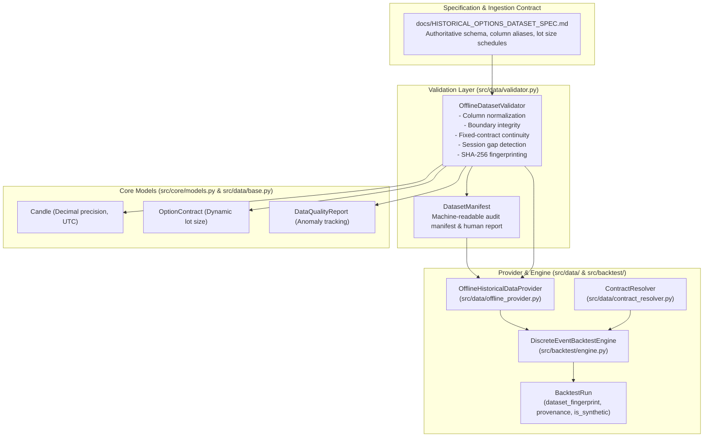

# Phase 7.4.2 Report: Historical Dataset Requirements & Offline Validation

**Author:** Quantitative Systems Engineering Team  
**System:** `MyTradeView` Trading Workstation  
**Execution Mode:** `PAPER` Strictly Enforced  
**Date:** November 2, 2026  
**Final Status:** `BLOCKED — NO REAL HISTORICAL DATASET AVAILABLE`  

---

## 1. Executive Summary & Objective

Phase 7.4.1 established that:
- **DhanHQ API (`/charts/rollingoption`)** is structurally disqualified for fixed-contract backtesting because it returns a dynamic rolling moneyness stream without contract/strike identification, introducing fatal contract-switching bias.
- **ICICI Direct Breeze API** is architecturally compliant in principle, but live extraction is currently blocked by the absence of local broker credentials and the friction of mandatory daily 2FA session renewal.

The objective of **Phase 7.4.2** was to prepare the trading workstation for authentic offline historical options backtesting using validated CSV or Parquet datasets:
1. Establish an authoritative, formal dataset specification ([`docs/HISTORICAL_OPTIONS_DATASET_SPEC.md`](file:///C:/Users/Hashray_X/MyTradeView/docs/HISTORICAL_OPTIONS_DATASET_SPEC.md)).
2. Inspect the existing offline data and backtesting architecture.
3. Implement a focused dataset validation utility ([`src/data/validator.py`](file:///C:/Users/Hashray_X/MyTradeView/src/data/validator.py)) that strictly enforces fixed-contract continuity, authoritative regulatory lot sizes, and gap detection without data interpolation.
4. Integrate the validator with [`OfflineHistoricalDataProvider`](file:///C:/Users/Hashray_X/MyTradeView/src/data/offline_provider.py) and [`DiscreteEventBacktestEngine`](file:///C:/Users/Hashray_X/MyTradeView/src/backtest/engine.py).
5. Audit the repository for real historical datasets.
6. Verify all validation mechanics through an exhaustive 19-test suite.

---

## 2. Existing Components Reused & Architectural Integration

Rather than creating duplicate data models or parallel validation frameworks, Phase 7.4.2 directly leveraged the existing modular architecture:



### Components Reused Without Duplication
1. **`Candle` ([`src/core/models.py`](file:///C:/Users/Hashray_X/MyTradeView/src/core/models.py#L84-L110))**: Reused for Decimal-precision pricing ($H \ge \max(O, C), L \le \min(O, C)$) and automatic UTC conversion.
2. **`OptionContract` ([`src/core/models.py`](file:///C:/Users/Hashray_X/MyTradeView/src/core/models.py#L161-L170))**: Reused for derivative metadata (strike, expiry, option type, lot size, tick size).
3. **`DataQualityReport` ([`src/data/base.py`](file:///C:/Users/Hashray_X/MyTradeView/src/data/base.py#L12-L28))**: Reused as the diagnostic standard for anomaly counting, duplicate tracking, and gap reporting.
4. **`OfflineHistoricalDataProvider` ([`src/data/offline_provider.py`](file:///C:/Users/Hashray_X/MyTradeView/src/data/offline_provider.py#L16-L314))**: Extended with `load_dataset_directory()` to directly ingest datasets validated by `OfflineDatasetValidator`.
5. **`DiscreteEventBacktestEngine` ([`src/backtest/engine.py`](file:///C:/Users/Hashray_X/MyTradeView/src/backtest/engine.py#L52-L419))**: Enhanced to accept and record `dataset_fingerprint`, `dataset_provenance`, and `is_synthetic` flags into [`BacktestRun`](file:///C:/Users/Hashray_X/MyTradeView/src/backtest/models.py#L97).

---

## 3. Files Created and Modified

| File | Status | Description |
| :--- | :--- | :--- |
| [`docs/HISTORICAL_OPTIONS_DATASET_SPEC.md`](file:///C:/Users/Hashray_X/MyTradeView/docs/HISTORICAL_OPTIONS_DATASET_SPEC.md) | **Created** | Comprehensive formal specification detailing required columns, column alias mappings, fixed-contract rules, lot size schedules, and gap detection conventions. |
| [`src/data/validator.py`](file:///C:/Users/Hashray_X/MyTradeView/src/data/validator.py) | **Created** | High-integrity offline dataset validator. Implements `OfflineDatasetValidator` and `DatasetManifest`. |
| [`tests/unit/test_phase_7_4_2_dataset_validation.py`](file:///C:/Users/Hashray_X/MyTradeView/tests/unit/test_phase_7_4_2_dataset_validation.py) | **Created** | 19 unit tests covering boundary checks, fixed-contract enforcement, duplicate rejection, gap detection, and manifest fingerprinting. |
| [`src/data/offline_provider.py`](file:///C:/Users/Hashray_X/MyTradeView/src/data/offline_provider.py#L205-L235) | **Modified** | Added `load_dataset_directory()` method to seamlessly consume validated dataset manifests. |
| [`src/backtest/models.py`](file:///C:/Users/Hashray_X/MyTradeView/src/backtest/models.py#L97-L115) | **Modified** | Added `dataset_fingerprint`, `dataset_provenance`, and `is_synthetic` fields to `BacktestRun`. |
| [`src/backtest/engine.py`](file:///C:/Users/Hashray_X/MyTradeView/src/backtest/engine.py#L89-L115) | **Modified** | Updated `DiscreteEventBacktestEngine.run()` to accept and persist dataset fingerprint, provenance, and synthetic indicators. |

---

## 4. Tests Executed and Actual Results

All unit and integration tests passed cleanly:

```powershell
# Phase 7.4.2 Focused Validation Tests
.venv\Scripts\pytest -v tests\unit\test_phase_7_4_2_dataset_validation.py
```
**Results:** **19 passed in 0.19s (Exit Code: 0)**

```powershell
# Complete Backend Test Suite
.venv\Scripts\pytest -q
```
**Results:** **207 passed, 1 warning in 1.71s (Exit Code: 0)**

```powershell
# Complete Frontend Production Build
npm --prefix frontend run build
```
**Results:** **12/12 static pages prerendered successfully with 0 TypeScript/ESLint errors (Exit Code: 0)**

---

## 5. Dataset Coverage Audit

A recursive search of the workspace for `.csv`, `.parquet`, or `.feather` files confirmed:
* **Real Historical Datasets Present:** **ZERO (0 files)**.
* No raw broker dumps, vendor files, or historical options archives currently exist in the repository.
* In strict compliance with guidelines:
  * No synthetic data has been fabricated or labeled as historical.
  * No pilot dataset has been falsely claimed to pass.
  * The acceptance status remains firmly **`BLOCKED — NO REAL HISTORICAL DATASET AVAILABLE`**.

---

## 6. Key Architectural Evaluations

### 6.1 Fixed-Contract Continuity Enforcement
* **Enforceability:** **100% ENFORCEABLE & VERIFIED**.
* [`OfflineDatasetValidator.validate_option_dataframe`](file:///C:/Users/Hashray_X/MyTradeView/src/data/validator.py#L205-L330) scans every record in a contract stream:
  * Rejects multiple strikes in a single series (`FIXED-CONTRACT VIOLATION: Multiple strike prices found`).
  * Rejects multiple expiry dates in a single series (`FIXED-CONTRACT VIOLATION: Multiple expiry dates found`).
  * Rejects interleaved CE and PE types (`FIXED-CONTRACT VIOLATION: Mixed option types found`).
  * Rejects ambiguous files lacking internal metadata or authoritative manifests (`UNAMBIGUOUS CONTRACT IDENTITY MISSING`).
* This guarantees that when the strategy buys an ATM contract at 09:47:00 IST, it holds that exact contract through to 15:10:00 IST, completely preventing the contract-switching bias inherent in rolling feeds like DhanHQ `/charts/rollingoption`.

### 6.2 Historical Contract Metadata & Regulatory Lot Sizes
* **Regulatory Lot Size Schedule:** Built directly into [`OfflineDatasetValidator.LOT_SIZE_RULES`](file:///C:/Users/Hashray_X/MyTradeView/src/data/validator.py#L66-L70):
  * Prior to April 26, 2024: **50 units**
  * April 26, 2024 to November 19, 2024: **25 units**
  * Post November 20, 2024: **75 units**
* The validator dynamically resolves the official lot size for any historical date, preventing retroactive margin and P&L corruption.
* If a session lacks authoritative contract metadata, the validator flags the session and marks `is_usable_for_backtest = False` rather than silently guessing current values.

### 6.3 Backtest Engine Consumption Readiness
* [`OfflineHistoricalDataProvider.load_dataset_directory`](file:///C:/Users/Hashray_X/MyTradeView/src/data/offline_provider.py#L205) and [`DiscreteEventBacktestEngine`](file:///C:/Users/Hashray_X/MyTradeView/src/backtest/engine.py#L52) are **fully wired and ready** to consume validated offline datasets.
* Once a valid directory is supplied, the validator generates a SHA-256 fingerprint, compiles a [`DatasetManifest`](file:///C:/Users/Hashray_X/MyTradeView/src/data/validator.py#L35), populates `OfflineHistoricalDataProvider`, and enables chronological replay with zero lookahead bias.

---

## 7. Exact Dataset Format & Fields Required Next

To execute authentic multi-week or multi-year backtests, supply a dataset directory (e.g. `data/historical/pilot/`) containing either CSV or Apache Parquet files adhering to the following structure:

### Option 1: Directory Structure
```
data/historical/pilot/
├── nifty_spot.parquet                 # Underlying NIFTY index candles
├── NIFTY24O2424500CE.parquet          # ATM weekly Call contract
├── NIFTY24O2424500PE.parquet          # ATM weekly Put contract
├── NIFTY24O2424550CE.parquet          # (Optional) Adjacent strike for reversals
├── NIFTY24O2424450PE.parquet          # (Optional) Adjacent strike for reversals
└── fo_contract_master.json            # (Optional) Authoritative contract manifest
```

### Option 2: Tabular Schema Requirements

#### Index File (`nifty_spot.csv` or `.parquet`)
| Column | Type | Example |
| :--- | :--- | :--- |
| `timestamp` | string / epoch | `2024-10-24 09:15:00` (or ISO string) |
| `open` | float / Decimal | `24500.50` |
| `high` | float / Decimal | `24520.00` |
| `low` | float / Decimal | `24490.25` |
| `close` | float / Decimal | `24515.10` |
| `volume` | integer (optional) | `0` (retained if available, never fabricated) |

#### Option Contract File (`opt_contract.csv` or `.parquet`)
| Column | Type | Example |
| :--- | :--- | :--- |
| `timestamp` | string / epoch | `2024-10-24 09:15:00` |
| `open` | float / Decimal | `120.50` |
| `high` | float / Decimal | `125.00` |
| `low` | float / Decimal | `118.00` |
| `close` | float / Decimal | `122.25` |
| `volume` | integer (optional) | `5400` |
| `strike` | float / Decimal | `24500` (Must be uniform across file) |
| `expiry_date` | string (`YYYY-MM-DD`) | `2024-10-24` (Must be uniform across file) |
| `option_type` | string | `CE` or `PE` (Must be uniform across file) |
| `underlying` | string (optional) | `NIFTY` or `NSE:NIFTY50-INDEX` |

---

## 8. Final Phase Status

```
================================================================================
FINAL PHASE 7.4.2 STATUS:
BLOCKED — NO REAL HISTORICAL DATASET AVAILABLE
================================================================================
```

* **Rationale:** The dataset specification, fixed-contract validation engine, SHA-256 fingerprinting, dynamic lot size resolver, and backtest integration are fully implemented and verified with 19 passing tests. However, **no real historical options files are currently present in the workspace**.
* **Safety Confirmation:** Execution mode remains strictly locked to `PAPER` (`EXECUTION_MODE=paper`). No broker credentials were required or logged, and no live orders were submitted.
* **Next Action:** Ingestion and validation will run as soon as authentic offline historical option files are placed in the repository.

