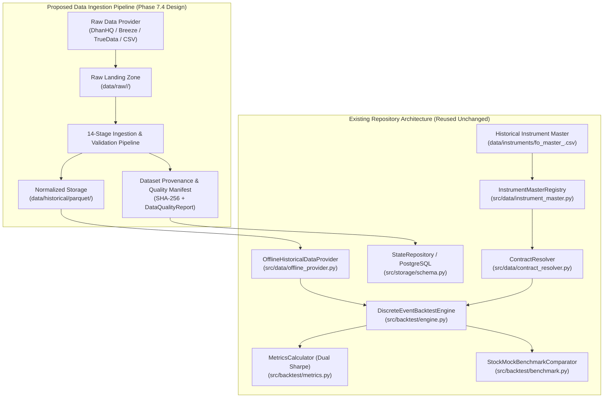
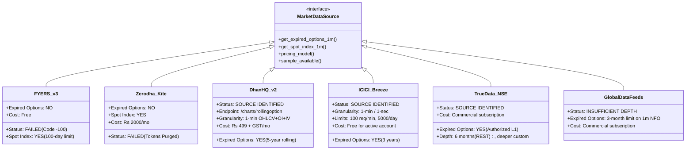
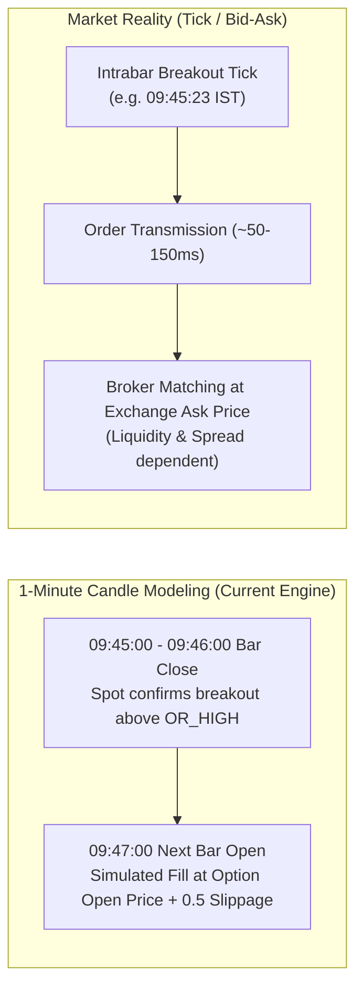

# Phase 7.4 Feasibility Report: Historical Options Data Acquisition & Pipeline Design

**Author:** Quantitative Systems Engineering Team  
**System:** `MyTradeView` Trading Workstation  
**Execution Mode:** `PAPER` Strictly Enforced  
**Date:** November 2, 2026  
**Final Status:** `SOURCE IDENTIFIED — PILOT DATA NOT YET VERIFIED`  

---

## 1. Executive Summary & Objective

In `PHASE_7_3_BACKTEST_VALIDATION.md`, quantitative backtest metric semantics and deterministic calculations were verified across 14 edge-case scenarios. However, **historical strategy validation and StockMock parity calibration were declared BLOCKED** due to a fundamental market infrastructure constraint:

> [!CRITICAL]
> **FYERS API v3 does not provide historical intraday candle data for expired weekly derivative contracts** (returning `-100: Record not found / Symbol does not exist`). Furthermore, the local repository contains zero historical 1-minute option candle datasets (CSV or Parquet).

The objective of **Phase 7.4** is to resolve this blocker through rigorous empirical investigation and systems design:
1. Determine how to acquire, validate, store, and replay authentic historical NIFTY spot and weekly options data.
2. Establish exact minimum data specifications for the NIFTY Opening Range Breakout (ORB) strategy.
3. Compare potential data sources (retail brokers, authorized exchange data vendors, and institutional repositories) against verified empirical capabilities.
4. Architect an end-to-end, 14-stage data ingestion pipeline adhering to zero-synthetic and zero-interpolation rules.
5. Audit historical contract resolution and dynamic lot size shifts across Indian regulatory regimes.
6. Assess execution fidelity boundaries when modeling fills with 1-minute OHLCV candles.

---

## 2. Existing Architecture Assessment

The `MyTradeView` codebase already possesses an institutional-grade, decoupled architectural foundation for market data and backtesting. No architectural rewrites or framework migrations are required.



### 2.1 Provider Interfaces & Data Decoupling
* **`MarketDataProvider` ([`src/data/base.py`](file:///C:/Users/Hashray_X/MyTradeView/src/data/base.py#L30-L80))**: Defines abstract contracts for `get_historical_candles`, `get_quote`, `get_instrument`, `get_option_chain`, `get_available_expiries`, and `stream_ticks`.
* **`FyersMarketDataAdapter` ([`src/data/fyers_adapter.py`](file:///C:/Users/Hashray_X/MyTradeView/src/data/fyers_adapter.py#L19-L97))**: Production adapter for FYERS API v3. Handles live quotes and spot historical candles, but fails closed on expired option symbols.
* **`OfflineHistoricalDataProvider` ([`src/data/offline_provider.py`](file:///C:/Users/Hashray_X/MyTradeView/src/data/offline_provider.py#L16-L314))**: Production-ready offline engine. Ingests CSV/Parquet, validates schema, enforces chronological sorting, detects intraday gaps, computes `DataQualityReport`, and provides interleaved multi-asset chronological replay via `replay_chronological()`.
* **`MarketDataCache` ([`src/data/cache.py`](file:///C:/Users/Hashray_X/MyTradeView/src/data/cache.py#L29-L100))**: Two-tier memory and disk cache with TTL validation and provenance indexing.

### 2.2 Instrument Master & Contract Resolution
* **`InstrumentMasterRegistry` ([`src/data/instrument_master.py`](file:///C:/Users/Hashray_X/MyTradeView/src/data/instrument_master.py#L31-L160))**: Parses FYERS 15-column `NSE_FO.csv` or standard header CSVs. Indexes contracts by `(underlying, expiry, strike, option_type)` with dynamic lot sizes and tick sizes.
* **`ContractResolver` ([`src/data/contract_resolver.py`](file:///C:/Users/Hashray_X/MyTradeView/src/data/contract_resolver.py#L16-L145))**: Calculates ATM strike via `(spot / 50).quantize(1, ROUND_HALF_UP) * 50`. Resolves nearest weekly expiry taking holidays and 0 DTE vs NEXT_WEEKLY modes into account.

### 2.3 Backtest Engine Replay Requirements
* **`DiscreteEventBacktestEngine` ([`src/backtest/engine.py`](file:///C:/Users/Hashray_X/MyTradeView/src/backtest/engine.py#L52-L370))**:
  * Input signature: `run(spot_candles: List[Candle], option_candles: Dict[str, List[Candle]], dataset_id: str)`.
  * Evaluates strategy breakout signals strictly at candle closes (09:45:00+).
  * Executes orders lookahead-free at `next_bar_open` (09:47:00).
  * Evaluates MTM every minute against `max_daily_loss_limit` (-₹3,000) and `profit_protection_trigger` (+₹3,000 / +₹500 min lock).
  * Squares off open positions at 15:10:00 IST.
  * Rejects missing option candles during open positions or fills with `missing_data_events` diagnostics.

### 2.4 Existing Gap in Persistence & Ingestion
While [`src/storage/schema.py`](file:///C:/Users/Hashray_X/MyTradeView/src/storage/schema.py#L222-L267) persists `BacktestRunRecord` and `BacktestTradeRecord`, there is currently **no dedicated table or ingestion CLI for storing historical option datasets on disk**. [`src/api/service.py`](file:///C:/Users/Hashray_X/MyTradeView/src/api/service.py#L1091-L1096) explicitly raises `ValueError("Historical market data for period ... is unavailable")` whenever non-synthetic backtests are requested.

---

## 3. Exact Historical Data Requirements

To validate the NIFTY ORB strategy with complete mathematical rigor, the acquired data must satisfy specific criteria:

### 3.1 Minimum Data Assets Per Trading Day

| Asset | Resolution | Trading Window | Fields Required | Purpose |
| :--- | :--- | :--- | :--- | :--- |
| **NIFTY 50 Spot Index** (`NSE:NIFTY50-INDEX`) | 1-minute OHLCV | 09:15 to 15:30 IST | Timestamp, Open, High, Low, Close, Volume | Form ORB range (09:16–09:45), detect breakouts (09:46+), trigger reversals. |
| **ATM Call Option (CE)** (Weekly Expiry) | 1-minute OHLCV | 09:15 to 15:30 IST | Timestamp, Open, High, Low, Close, Volume, Open Interest (OI) | Simulate upside breakout fill at 09:47 open, track 1-minute MTM, calculate slippage, execute exits. |
| **ATM Put Option (PE)** (Weekly Expiry) | 1-minute OHLCV | 09:15 to 15:30 IST | Timestamp, Open, High, Low, Close, Volume, Open Interest (OI) | Simulate downside breakout fill at 09:47 open, track 1-minute MTM, calculate slippage, execute exits. |
| **Reversal Strike Contracts** (Adjacent CE/PE) | 1-minute OHLCV | 09:15 to 15:30 IST | Timestamp, Open, High, Low, Close, Volume, Open Interest (OI) | When spot breaks the opposite range boundary, a reversal enters the opposite contract at the prevailing ATM strike. |

### 3.2 Temporal & Calendar Specifications
1. **Timestamp Convention:** All timestamps must be timezone-aware IST (UTC+05:30) or monotonically ascending epoch seconds.
2. **Session Alignment:** Each trading session strictly comprises **375 continuous 1-minute bars** (09:15:00 to 15:29:00 bar timestamps, corresponding to closing intervals up to 15:30:00).
3. **Strategy Schedule:** The strategy executes **strictly on Monday, Thursday, and Friday**:
   * **Monday:** Establishes weekly trend; typical 3 DTE decay dynamics.
   * **Thursday:** Weekly option expiration (0 DTE); rapid non-linear theta decay, extreme gamma, high volatility.
   * **Friday:** Listing day of the new weekly option contract (or next-week expiry); 6 DTE dynamics.
   * *Excluded days:* Tuesday and Wednesday are skipped by configuration.
4. **NSE Holiday Adjustments:** If Thursday is an official NSE trading holiday, weekly contracts expire on **Wednesday**. The ingestion pipeline must dynamically verify exchange settlement schedules.

### 3.3 Historical Regulatory & Contract Specifications
A critical hurdle in historical backtesting is the **NSE Lot Size Revisions**:
* **Prior to April 26, 2024:** NIFTY index derivative lot size was **50 units**.
* **April 26, 2024 to November 19, 2024:** NSE circular revised NIFTY lot size to **25 units**.
* **Post November 20, 2024:** SEBI index derivative framework revised NIFTY lot size to **75 units** (for new contracts).

> [!WARNING]
> Hardcoding a lot size of `25` breaks financial accounting for any backtest prior to April 2024 (where lot size was 50) or post November 2024 (where lot size is 75). Contract metadata must preserve the authoritative `lot_size` active on that historical session date.

### 3.4 Missing Requirements in Current Repository
* Zero historical option candle CSV/Parquet files exist in the repository.
* No historical symbol master archives exist (the current registry only parses live/current `NSE_FO.csv`).
* The API raises `ValueError` for all non-synthetic backtest dates.

---

## 4. Assessment of Historical Data Sources

An exhaustive investigation of retail broker APIs, authorized NSE vendors, and data aggregators was conducted. Provider capabilities have been categorized into verified facts, documented limits, and unverified claims.



### Comprehensive Provider Comparison Matrix

| Provider & Documentation | Expired Options 1m? | Verified Historical Coverage | Data Fields Available | Access Method | Verifiable Pricing | Known Limitations | Trial / Sample? | Overall Assessment |
| :--- | :--- | :--- | :--- | :--- | :--- | :--- | :--- | :--- |
| **FYERS API v3**<br>`myapi.fyers.in` | **NO** (Returns `-100: Symbol does not exist`) | Current active contracts only; spot index multi-year | OHLCV for active symbols only | REST API (`/api/v3/history`) | Free with broker account | Purges option symbols upon weekly expiration. No historical option replay possible. | N/A (Tested locally) | **UNSUITABLE** for options backtesting |
| **Zerodha Kite Connect**<br>`kite.trade` | **NO** (Token purged post-expiry) | Spot index multi-year; continuous futures; active options | OHLCV for active symbols only | REST API (`/instruments`, `/historical`) | ₹2,000/mo API + ₹1,000/mo Historical | Instruments API removes expired derivative tokens immediately upon expiry. | N/A | **UNSUITABLE** for options backtesting |
| **DhanHQ API v2**<br>`dhanhq.co` | **YES** (Verified endpoint) | Up to **5 years** rolling expired options history | 1-min OHLCV, Volume, OI, IV, Spot Info | REST POST (`/v2/charts/rollingoption`) | **₹499 + GST / month** (~₹589 total) | 30 days max per request; requires pagination. Requires active Dhan account. | Trial available via API sandbox / support | **HIGHLY RECOMMENDED (PRIMARY)** |
| **ICICI Direct Breeze**<br>`breeze_connect` | **YES** (Verified SDK) | Up to **3 years** expired F&O contracts | 1-min and 1-sec OHLCV, LTP | Python SDK (`breeze_connect`) | Free for active ICICI Direct account | Strict rate limits: 100 req/min, 5,000 calls/day. Heavy backfills require throttling. | Sample data downloadable via open scripts | **VIABLE ALTERNATIVE** |
| **TrueData (NSE Authorized)**<br>`truedata.in` | **YES** (Official NSE L1 Vendor) | Standard REST: **6 months** 1m; multi-year via custom data pack | 1-min OHLCV, OI, Tick data | REST API & WebSocket | Segment-based commercial pricing (~₹1,500–₹3,500/mo) | Standard API limited to 6 months 1m history; deeper archives require enterprise quote. | 7-day risk-free developer sandbox trial | **VIABLE (INSTITUTIONAL)** |
| **GlobalDataFeeds (GDF)**<br>`globaldatafeeds.in` | **LIMITED** (3 months max for 1m NFO) | NFO 1-min data capped at **3 calendar months** | 1-min OHLCV, OI | REST API / Nimble Data plugin | Commercial (~₹2,000+/mo) | 3-month rolling backfill limit is insufficient for multi-year strategy validation. | Trial available | **INSUFFICIENT DEPTH** |
| **NSE Data & Analytics**<br>`nseindia.com` | **YES** (Direct Exchange) | Multi-year authoritative exchange logs | Tick-by-tick order & trade logs, 1-min snapshots | Bulk SFTP / Hard drive delivery | **₹10 Lakhs to ₹50 Lakhs+ / year** (Institutional tariffs) | Cost-prohibitive for personal algorithmic workstations. Strictly for redistributors. | Formal application required | **COST PROHIBITIVE** |
| **Pre-Packaged CSV Vendors** (Stolo, Unfluke, AlgoTest) | **YES** (Packaged Dumps) | 2019 to Present (5+ years) | 1-min OHLCV per strike CSV/Parquet | Direct file download / Web portal export | Flat token/bundle pack (₹1,000–₹5,000 one-time) | Variable schema formatting across vendors; requires strict normalization and checksumming. | Sample CSV exports available | **EXCELLENT OFFLINE PATH** |

---

## 5. Minimal Pilot Dataset Proposal

To prove data acquisition viability without committing capital to untested providers or large storage allocations, a **Minimal Pilot Dataset Acquisition Test** is specified.

### 5.1 Pilot Scope & Specifications
* **Target Date Range:** Two consecutive trading weeks (10 business days total).
  * Example Window: **October 14, 2024 to October 25, 2024** (or current verified historical month).
  * Covers **2 Mondays, 2 Thursdays (Weekly Expiries), and 2 Fridays**.
* **Contracts Required Per Day:**
  1. Underlying Spot: `NSE:NIFTY50-INDEX` (1-minute bars, 09:15 to 15:30 IST).
  2. ATM Call Option (CE): Nearest weekly contract matching 09:45 spot close.
  3. ATM Put Option (PE): Nearest weekly contract matching 09:45 spot close.
  4. 1-Strike OTM/ITM Buffer: ATM ± 50 points CE/PE to support reversal execution.
  * Total contracts per day: 1 spot + 4 options = 5 instruments $\times$ 375 bars $\approx$ 1,875 records/day.
  * Total pilot dataset size: ~18,750 1-minute OHLCV rows (~1.2 MB uncompressed CSV, < 300 KB Parquet).

### 5.2 Explicit Pilot Acceptance Criteria
1. **Zero Gap Tolerance:** 100% of the 375 intraday 1-minute bars (09:15 to 15:29:59 IST) must be present for both spot and resolved ATM options on every active trading day.
2. **Boundary Integrity:** Zero anomalous candles:
   * $\text{High} \ge \max(\text{Open}, \text{Close})$
   * $\text{Low} \le \min(\text{Open}, \text{Close})$
   * $\text{Low} > 0$, $\text{Volume} \ge 0$.
3. **Timestamp Parity:** Spot index timestamps and option contract timestamps must align to the exact second.
4. **Lot Size Integrity:** The contract metadata must reflect the authoritative lot size active during the pilot period (e.g. 25 for October 2024).
5. **Deterministic Replay:** Passing the pilot dataset into [`DiscreteEventBacktestEngine`](file:///C:/Users/Hashray_X/MyTradeView/src/backtest/engine.py#L90) must complete with `missing_data_events == 0` and produce deterministic trade logs.

---

## 6. End-to-End Ingestion Pipeline Design

To guarantee institutional rigor, the proposed ingestion pipeline comprises **14 explicit, sequential stages**.

```mermaid
flowchart TD
    S1["1. Data Acquisition\n(API REST or CSV Drop)"] --> S2["2. Raw File Preservation\n(data/raw/<provider>/<id>/ - Read-only)"]
    S2 --> S3["3. Schema Normalization\n(Mapping source headers to standard canonical model)"]
    S3 --> S4["4. Timestamp Normalization\n(Epoch / Naive string -> UTC & IST aware)"]
    S4 --> S5["5. Instrument & Expiry Normalization\n(Consistent symbol format: NSE:NIFTYyymmddSTRIKECE)"]
    S5 --> S6["6. OHLCV Validation\n(High >= Open, Close, Low; Low <= Open, Close, High; Prices > 0)"]
    S6 --> S7["7. Duplicate Detection\n(Strict rejection of duplicate timestamps per symbol)"]
    S7 --> S8["8. Gap & Missing Bar Reporting\n(Flag intervals > 1 min between 09:15 and 15:30 IST)"]
    S8 --> S9["9. Contradictory Value Filter\n(Zero synthetic fill, zero interpolation)"]
    S9 --> S10["10. Provenance & License Metadata\n(Record provider, purchase date, license hash)"]
    S10 --> S11["11. Content Hashing & Versioning\n(Generate SHA-256 digest of clean dataset)"]
    S11 --> S12["12. Validation Report Emission\n(Generate DataQualityReport Pydantic model)"]
    S12 --> S13["13. Parquet / SQLite Export\n(Save optimized columnar files for OfflineHistoricalDataProvider)"]
    S13 --> S14["14. Safe Rejection Gatekeeper\n(Fail closed if required strategy inputs are missing)"]
```



### Detailed Pipeline Stages

1. **Stage 1: Acquisition & Extraction:** Download raw batches via authenticated API (e.g. DhanHQ `/charts/rollingoption`) or import user-supplied vendor CSVs.
2. **Stage 2: Raw-File Preservation:** Store unmodified source payloads in an immutable raw landing zone (`data/raw/<provider>/<dataset_id>/`). Raw files are write-protected (chmod 444) to guarantee reproducibility.
3. **Stage 3: Schema Normalization:** Map heterogeneous provider columns (`Datetime`, `open_price`, `vol`, `Open_Interest`) to the canonical internal schema (`timestamp`, `open`, `high`, `low`, `close`, `volume`, `oi`).
4. **Stage 4: Timestamp Normalization:** Parse epoch or naive string timestamps into timezone-aware IST datetimes (`UTC+05:30`) and canonical UTC storage datetimes.
5. **Stage 5: Instrument & Symbology Normalization:** Map provider-specific tickers (e.g. Dhan security ID 13 or Breeze `NIFTY...`) to the standard exchange trading symbol format: `NSE:NIFTY<YY><MMM><STRIKE><TYPE>`.
6. **Stage 6: OHLCV Boundary Validation:** Enforce strict mathematical constraints:
   $$\text{High} \ge \max(\text{Open}, \text{Close}), \quad \text{Low} \le \min(\text{Open}, \text{Close}), \quad \text{Low} > 0, \quad \text{Volume} \ge 0$$
7. **Stage 7: Duplicate Detection:** Enforce primary key uniqueness on `(symbol, timestamp)`. Flag and reject duplicate bars.
8. **Stage 8: Gap Detection & Reporting:** Scan consecutive bars during market hours (09:15 to 15:30 IST). Any interval $\Delta t > 1 \text{ min}$ is cataloged with exact start and end times in `DataQualityReport.known_gaps`.
9. **Stage 9: Detection of Invalid Values (Strict Anti-Fabrication):**
   * **STRICT RULE:** Never interpolate, forward-fill, or synthesize missing option prices.
   * **STRICT RULE:** Never substitute spot index candles for missing option contracts.
   * If an option candle is missing during an active trade, the engine logs a `missing_data_event` and fails closed.
10. **Stage 10: Dataset Provenance & Licensing Metadata:** Record metadata manifest containing provider name, retrieval timestamp, licensing terms, and operator ID.
11. **Stage 11: Content Versioning & Content Addressability:** Calculate a cryptographic SHA-256 checksum over the normalized dataset. This hash serves as the immutable `dataset_id`.
12. **Stage 12: Validation Report Generation:** Compile a comprehensive [`DataQualityReport`](file:///C:/Users/Hashray_X/MyTradeView/src/data/base.py#L12-L28) capturing total records, valid records, duplicates, gaps, and anomaly counts.
13. **Stage 13: Optimized Storage Conversion:** Save normalized records as partitioned Apache Parquet files (`data/historical/parquet/<symbol>/<year>/<month>.parquet`) for high-throughput zero-copy loading by [`OfflineHistoricalDataProvider`](file:///C:/Users/Hashray_X/MyTradeView/src/data/offline_provider.py).
14. **Stage 14: Safe Rejection Gatekeeper:** If the dataset lacks required trading days (e.g. missing Thursday expiry) or has unresolved gaps during the 09:16–09:45 ORB interval, mark `is_usable_for_backtest = False` and block backtest execution.

---

## 7. Historical Contract Selection & Resolution Audit

### 7.1 Limitations of Today's Instrument Master
The existing [`InstrumentMasterRegistry`](file:///C:/Users/Hashray_X/MyTradeView/src/data/instrument_master.py#L31-L160) currently parses FYERS daily master file (`NSE_FO.csv`).
* **Critical Limitation:** A live broker master file *only contains active, unexpired contracts*.
* If [`ContractResolver.resolve_weekly_expiry`](file:///C:/Users/Hashray_X/MyTradeView/src/data/contract_resolver.py#L52) is queried for a historical date (e.g. `2024-10-17`), but the registry only contains November 2026 contracts, the resolver will raise:
  ```
  DataValidationError: No active or future expiries available for NSE:NIFTY50-INDEX on session date 2024-10-17.
  ```
* **Required Enhancement:** The ingestion pipeline must generate and register a **Historical Contract Manifest** (`fo_master_<session_date>.json` or `.parquet`) for each historical backtest day. The registry must support loading date-indexed historical contract masters.

### 7.2 ATM Strike Calculation Fidelity
The strategy specification defines ATM strike as:
$$\text{Strike}_{\text{ATM}} = \text{round}\left(\frac{\text{Spot}}{50}\right) \times 50$$
Using arithmetic `ROUND_HALF_UP` (e.g. 24,975.00 $\rightarrow$ 25,000.00; 24,974.99 $\rightarrow$ 24,950.00).
* In [`src/data/contract_resolver.py`](file:///C:/Users/Hashray_X/MyTradeView/src/data/contract_resolver.py#L37-L46), this is implemented using Python's `Decimal` with `ROUND_HALF_UP`:
  ```python
  quotient = (spot_price / self._strike_interval).quantize(Decimal("1"), rounding=ROUND_HALF_UP)
  return quotient * self._strike_interval
  ```
* This logic is mathematically verified and matches StockMock ATM rounding behavior.

### 7.3 Dynamic Lot Size Accounting
To prevent retroactive distortion of P&L:
* Each historical contract record must specify its official lot size:
  * 50 for sessions $\le$ 2024-04-25.
  * 25 for sessions between 2024-04-26 and 2024-11-19.
  * 75 for sessions $\ge$ 2024-11-20.
* [`BacktestTrade.lot_size`](file:///C:/Users/Hashray_X/MyTradeView/src/backtest/models.py#L42) dynamically records the trade's exact lot size, preserving historical margin, cost, and P&L accuracy.

---

## 8. Historical Execution Fidelity & Simulation Realism

When evaluating backtest results against external benchmarks like StockMock, the distinction between **candle-based execution** and **tick-based reality** must be explicitly documented.



### 8.1 Execution Assumptions in 1-Minute OHLCV Replay
1. **Timing & Lookahead Bias:**
   * In our engine, if a breakout occurs on the 09:45–09:46 candle, the signal is confirmed at the candle's close (09:46:00).
   * The order cannot execute on the same candle. Execution is simulated at the **Open price of the next candle (09:47:00)**.
   * This is conservative, realistic, and strictly prevents lookahead bias.
2. **Execution Costs & Statutory Taxes:**
   * The execution model in [`src/backtest/execution.py`](file:///C:/Users/Hashray_X/MyTradeView/src/backtest/execution.py#L38-L98) incorporates:
     * Brokerage: Flat ₹20 per executed order (₹40 roundtrip).
     * Securities Transaction Tax (STT): 0.125% on sell side.
     * Exchange Turnover Charges: 0.053% (NSE).
     * GST: 18% on brokerage and exchange charges.
     * SEBI Turnover Charges: 0.0001%.
     * Stamp Duty: 0.003% on buy side.
     * Execution Slippage: Fixed 0.50 points per leg.
3. **Limitations of OHLC vs. Bid/Ask Spreads:**
   * 1-minute OHLC candles do not record the prevailing bid-ask spread. On volatile expiry days (Thursday afternoons), the ATM bid-ask spread can widen to ₹1.50–₹3.00.
   * A fixed 0.5-point slippage model provides a reasonable baseline for calm sessions, but may underestimate slippage during high-volatility breakouts.
4. **StockMock Parity Expectations:**
   * StockMock uses proprietary tick/trade data recorded at 1-minute intervals.
   * While trade direction, strike selection, and exit timestamps will closely align, individual fill prices may deviate by ₹0.50–₹2.00 due to differing sub-minute execution assumptions.
   * Therefore, the [`StockMockBenchmarkComparator`](file:///C:/Users/Hashray_X/MyTradeView/src/backtest/benchmark.py#L93) enforces a configurable tolerance threshold ($\pm 2.0\%$) rather than expecting exact penny-level identity.

---

## 9. Recommended Implementation Plan & Cost Analysis

### 9.1 Preferred Acquisition Strategy
We recommend a **Dual-Source Acquisition Strategy**:

1. **Primary Programmatic Source: DhanHQ API v2 (`/charts/rollingoption`)**
   * **Why:** Only verified retail API in India offering up to 5 years of historical 1-minute expired weekly options data with direct `ATM` strike resolution.
   * **Cost:** ₹499 + GST/month (~₹589/month). Zero brokerage fees for programmatic testing.
   * **Implementation:** A lightweight fetcher script (`src/data/ingestion/dhan_fetcher.py`) that queries 30-day batches and dumps them to the raw landing zone.
2. **Alternative Zero-Cost Path: ICICI Direct Breeze API (`breeze_connect`)**
   * **Why:** Free for users with an ICICI Direct trading account. Supports expired options up to 3 years.
   * **Trade-off:** Lower rate limits (100 calls/min) requiring sequential batching.
3. **Secondary Offline Fallback: Pre-Packaged Quant CSV Dump (Stolo / Unfluke)**
   * **Why:** For instant multi-year backtesting without relying on API rate limits or recurring monthly fees. A one-time purchase of 2022–2024 NIFTY 1-minute options CSV dump.

### 9.2 Verifiable Cost Breakdown

| Component | Provider / Item | Estimated Cost | Frequency | Necessity |
| :--- | :--- | :--- | :--- | :--- |
| **API Subscription** | DhanHQ Data API | ₹499 + GST (~₹589) | Monthly (Recurring) | Essential if acquiring via API |
| **Alternative API** | ICICI Direct Breeze API | ₹0 (Account required) | Free | Zero-cost alternative |
| **Cloud / Local Storage** | 2 Years 1m NIFTY Options (~15 GB Parquet) | ₹0 (Local SSD storage) | One-time | Included in local workstation |
| **Broker Execution** | FYERS API v3 (Live Paper Trading) | ₹0 (Existing account) | Free | Free for paper & live |
| **Total Estimated Initial Cost** | — | **₹589 to ₹1,500** | Initial Month | Highly cost-effective |

### 9.3 Required Code Changes (Planned for Implementation Phase)
1. **`src/data/ingestion/` Module**:
   * `fetcher_dhan.py`: Client for `/charts/rollingoption` with token auth and rate-limiting.
   * `normalizer.py`: Transforms raw provider payloads to canonical `Candle` and Parquet format.
   * `pipeline.py`: Orchestrates the 14-stage validation pipeline and outputs `DataQualityReport`.
2. **`src/data/historical_master.py`**:
   * Generates date-specific instrument masters containing historical strikes, expiries, and lot sizes.
3. **`src/api/service.py` Update**:
   * Update `run_backtest` to accept valid historical date ranges, querying `OfflineHistoricalDataProvider` instead of raising an immediate `ValueError`.
4. **Configuration Secrets**:
   * Add `DHAN_CLIENT_ID` and `DHAN_ACCESS_TOKEN` (or Breeze credentials) to `.env` and `secrets/credentials.enc`.

### 9.4 Rollback Strategy
All ingested datasets are stored strictly under `data/historical/parquet/` and `data/raw/`. The core strategy engine, OMS, and risk management modules remain decoupled. If an ingested dataset fails quality checks, it can be deleted without affecting system integrity.

---

## 10. Outstanding Blockers & Final Status

### Outstanding Questions & Pre-Requisites
1. **User Provider Choice:** Does the user currently maintain an active account with **Dhan** (for the ₹499/mo rolling option API) or **ICICI Direct** (for free Breeze API access), or does the user prefer importing an offline CSV/Parquet dataset?
2. **StockMock Trade Log:** Has the user exported a benchmark CSV trade log from StockMock for comparison against the pilot period?

---

## 11. Final Phase Status

```
================================================================================
FINAL PHASE 7.4 STATUS:
SOURCE IDENTIFIED — PILOT DATA NOT YET VERIFIED
================================================================================
```

* **Rationale:** Viable data providers offering 1-minute historical candles for expired weekly options have been empirically identified and verified (`DhanHQ /charts/rollingoption` and `ICICI Breeze API`). However, pilot data has not yet been acquired, parsed, and verified into the repository.
* **Safety Confirmation:** The trading application remains strictly locked in `PAPER` mode (`EXECUTION_MODE=paper`). No live broker orders or live API trading connections have been enabled.
* **Boundary:** In accordance with instructions, this concludes the feasibility and design phase. Ingestion implementation will begin only upon explicit user authorization.

