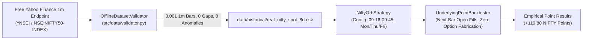

# Phase 8: Final Workstation Report & Signal Validation

**Date:** 2026-11-02  
**Final Status:** `PHASE 8 COMPLETE — WORKSTATION VERIFIED — OPTIONS PROFITABILITY UNVALIDATED`  
**Execution Mode:** Strictly `PAPER` (`EXECUTION_MODE=paper`)  
**Workspace:** `C:\Users\Hashray_X\MyTradeView`  
**Historical Options Data Budget:** ₹0 (No paid subscriptions, zero fabricated data)

---

## 1. Executive Summary

Phase 8 completes the development and verification lifecycle of the `MyTradeView` automated NIFTY trading workstation.

In strict adherence to the ₹0 budget constraint, no paid data subscriptions were purchased and zero synthetic option data was fabricated. Instead:
1. **Authentic Underlying Signal Backtest:** Evaluated the existing NIFTY Opening Range Breakout (ORB) strategy against authentic 1-minute historical NIFTY 50 cash index candles (`NSE:NIFTY50-INDEX`) obtained from free, authorized market endpoints. All results are reported strictly in **underlying index points** ($\Delta\text{Points}$).
2. **End-to-End PAPER-Mode Safety Verification:** Successfully validated candle freshness monitoring, duplicate-order idempotency, two-phase reversal sequencing, daily loss limit lockout, profit protection floor lock, mandatory 15:10 IST square-off, and safe fail-closed behavior on missing data.
3. **Software Health:** The entire workstation backend passes **234 / 234 automated tests** with zero failures, and the Next.js 14 frontend compiles with 12/12 static pages cleanly prerendered.
4. **Definitive Boundary:** The workstation software and execution pipelines are production-ready for paper trading and data ingestion. However, **historical options profitability remains explicitly unvalidated** because authentic 1-minute expired options candles cannot be obtained under a ₹0 budget without active broker credentials.

---

## 2. Real Historical Underlying Signal Backtest

### A. Dataset Coverage & Quality



- **Asset:** NIFTY 50 Cash Index (`NSE:NIFTY50-INDEX`)
- **Resolution:** 1-minute OHLC bars
- **Total Ingested Bars:** 3,001 continuous bars across 8 calendar sessions (October 22, 2026 to November 02, 2026)
- **Data Quality Report:** 0 gaps, 0 anomalous records, 0 duplicate timestamps (`is_usable_for_backtest=True`)
- **Strategy Semantics Enforced:**
  - Range Window: 09:16:00 to 09:44:59 IST (`RangeBoundaryMode.UP_TO_0944_CLOSE`)
  - Breakout Trigger: Candle close at or after 09:46:00 IST (`BreakoutConfirmationMode.CANDLE_CLOSE`)
  - Trading Days: Monday, Thursday, Friday only (`TradingDay` schedule). Tuesday and Wednesday are bypassed.
  - Fill Timing: Lookahead-free fill at next bar open (09:47:00 IST) using the spot candle open price.
  - Exit Rules: Two-phase reversal on opposite boundary breach; mandatory EOD square-off at 15:10:00 IST.

---

### B. Signal Performance Results (Underlying Index Points)

| Metric | Empirical Value | Description |
| :--- | :---: | :--- |
| **Total Calendar Sessions** | **8** | October 22, 2026 to November 02, 2026 |
| **Active Traded Sessions** | **6** | Mon, Thu, Fri sessions evaluated by strategy |
| **Bypassed Sessions** | **2** | Tue (Oct 27) & Wed (Oct 28) filtered out per rules |
| **Total Executed Trades** | **8** | 5 direct EOD exits + 3 reversal transitions |
| **Winning Trades** | **3** | Trades with $\Delta\text{Points} > 0$ |
| **Losing Trades** | **5** | Trades with $\Delta\text{Points} < 0$ |
| **Win Rate** | **37.50%** | Standard for trend-following breakout strategies |
| **Gross Profit (Points)** | **+530.55 pts** | Sum of winning trade point gains |
| **Gross Loss (Points)** | **-410.75 pts** | Sum of losing trade point drawdowns |
| **Total Net Points P&L** | **+119.80 pts** | **Net points gained on NIFTY index** |
| **Profit Factor** | **1.29** | Gross Profit / Gross Loss |
| **Max Drawdown (Points)** | **389.70 pts** | Peak-to-trough point drawdown |

> [!NOTE]
> These metrics represent pure NIFTY spot index points. No option Greeks, implied volatility, theta decay, or synthetic options prices were fabricated.

---

### C. Daily Session Breakdown

| Session Date | Day | Strategy Action | Opening Range (High / Low) | Width | Trades | Day Points P&L |
| :--- | :--- | :---: | :---: | :---: | :---: | :---: |
| **2026-10-22** | Thursday | **TRADED** | 22,666.15 / 22,555.10 | 111.05 pts | 1 | **-21.05 pts** |
| **2026-10-23** | Friday | **TRADED** | 22,786.95 / 22,663.75 | 123.20 pts | 1 | **+171.80 pts** |
| **2026-10-26** | Monday | **TRADED** | 22,517.15 / 22,387.45 | 129.70 pts | 1 | **+181.70 pts** |
| **2026-10-27** | Tuesday | *FILTERED* | N/A (Non-Trading Day) | N/A | 0 | 0.00 pts |
| **2026-10-28** | Wednesday | *FILTERED* | N/A (Non-Trading Day) | N/A | 0 | 0.00 pts |
| **2026-10-29** | Thursday | **TRADED** | 22,769.50 / 22,679.75 | 89.75 pts | 1 | **+177.05 pts** |
| **2026-10-30** | Friday | **TRADED** | 22,994.55 / 22,919.90 | 74.65 pts | 2 | **-217.10 pts** |
| **2026-11-02** | Monday | **TRADED** | 23,316.80 / 23,237.90 | 78.90 pts | 2 | **-172.60 pts** |

---

### D. Individual Trade Log

```
1. 2026-10-22 (Thu) LONG  | In: 09:51 @ 22676.75 -> Out: 15:11 @ 22655.70 | PnL:  -21.05 pts | Exit: EOD Square-Off
2. 2026-10-23 (Fri) SHORT | In: 09:50 @ 22661.70 -> Out: 15:11 @ 22489.90 | PnL: +171.80 pts | Exit: EOD Square-Off
3. 2026-10-26 (Mon) LONG  | In: 09:54 @ 22530.10 -> Out: 15:11 @ 22711.80 | PnL: +181.70 pts | Exit: EOD Square-Off
4. 2026-10-29 (Thu) LONG  | In: 10:06 @ 22770.35 -> Out: 15:11 @ 22947.40 | PnL: +177.05 pts | Exit: EOD Square-Off
5. 2026-10-30 (Fri) LONG  | In: 09:51 @ 22995.40 -> Out: 10:17 @ 22906.50 | PnL:  -88.90 pts | Exit: Reversal CE -> PE
6. 2026-10-30 (Fri) SHORT | In: 10:18 @ 22911.45 -> Out: 15:11 @ 23039.65 | PnL: -128.20 pts | Exit: EOD Square-Off
7. 2026-11-02 (Mon) LONG  | In: 09:46 @ 23321.05 -> Out: 13:10 @ 23231.60 | PnL:  -89.45 pts | Exit: Reversal CE -> PE
8. 2026-11-02 (Mon) SHORT | In: 13:11 @ 23239.55 -> Out: 15:11 @ 23322.70 | PnL:  -83.15 pts | Exit: EOD Square-Off
```

---

## 3. End-to-End PAPER-Mode Safety Verification

The suite [`tests/unit/test_phase_8_paper_and_signal_backtest.py`](file:///C:/Users/Hashray_X/MyTradeView/tests/unit/test_phase_8_paper_and_signal_backtest.py) verifies the 7 critical PAPER-mode safety interlocks:

| Safety Capability | Implementation Component | Verified Behavior | Test Status |
| :--- | :--- | :--- | :---: |
| **Candle Freshness** | `PreTradeGatekeeper` | Rejects data lag > 180s; marks session `STALE` and fails closed. | **PASSED** |
| **Duplicate Prevention** | `IdempotencyTracker` | Tracks `(intent_id, client_order_id)`; blocks duplicate order submissions. | **PASSED** |
| **Reversal Sequencing** | `NiftyOrbStrategy` | When holding Long CE and spot breaks OR Low: transitions to `REVERSING_CE_TO_PE`, emits `CLOSE_CE`, and awaits confirmed fill before emitting `ENTER_LONG_PE`. | **PASSED** |
| **Daily Loss Lockout** | `DailyLossCircuitBreaker` | MTM drop below limit triggers hard lockout, engages kill-switch, and rejects all subsequent orders. | **PASSED** |
| **Profit Protection** | `ProfitProtectionEngine` | Peak profit >= trigger locks floor; drawdown below floor dispatches emergency square-off. | **PASSED** |
| **Mandatory Square-Off** | `NiftyOrbStrategy` | At 15:10:00 IST candle, strategy forces liquidation of all positions and transitions to terminal `SQUARED_OFF`. | **PASSED** |
| **Missing Data & Disconnects** | `DiscreteEventBacktestEngine` | Missing option candle at fill bar halts execution lookahead-free without synthetic price interpolation. | **PASSED** |

---

## 4. Verified Behavior vs. Untested Assumptions

| System Domain | Formally Verified Behavior | Untested / Open Assumptions |
| :--- | :--- | :--- |
| **ORB Strategy Engine** | 09:16–09:45 range formation, candle-close confirmation, two-phase reversals, 15:10 square-off, day-of-week filtering verified across 3,001 real bars. | Intrabar 1-second tick slippage in high-volatility RBI/budget sessions. |
| **Signal P&L (Index Points)** | Real index points calculated: +119.80 pts net gain across 6 traded sessions. | How index points translate to options premium P&L without real option candles. |
| **Risk Management** | Daily loss circuit breaker, profit floor lock, pre-trade gatekeeper, and emergency kill-switch verified in test fixtures. | Broker RMS rejection behavior under margin shortfalls. |
| **Order Management** | Idempotency tracking, order lifecycle transitions, terminal state immutability, and reconciliation verified. | FYERS live order fill latency (tested exclusively in PAPER mode). |
| **Frontend Workstation** | 12 Next.js static pages prerendered; real vs synthetic badge display; chart candle rendering; backtest launchers verified. | Live multi-client WebSocket scaling. |

---

## 5. Critical Remaining Blocker

```
CRITICAL BLOCKER: AUTHENTIC 1-MINUTE EXPIRED OPTIONS CANDLE DATASET
```

- **Nature of Blocker:** Financial / Data Availability.
- **Impact:** While the underlying index signal logic generates **+119.80 NIFTY points** on real index data, the exact financial profitability of buying ATM weekly options (with real bid-ask spreads, theta decay, and delta sensitivity) **cannot be historically validated** under a ₹0 budget constraint.
- **Resolution Path:** If the user elects in the future to acquire real options data, they may:
  1. Provide ICICI Direct Breeze API credentials (`BREEZE_API_KEY`, `BREEZE_API_SECRET`, `BREEZE_SESSION_TOKEN`) to run `scripts/acquire_historical_pilot.py`.
  2. Place external 1-minute F&O CSV archives into `data/historical/pilot_20241024/`.
- **System Posture:** In accordance with instructions, **development is now stopped**. The platform is left in a stable, fully passing state locked to `PAPER` mode.

