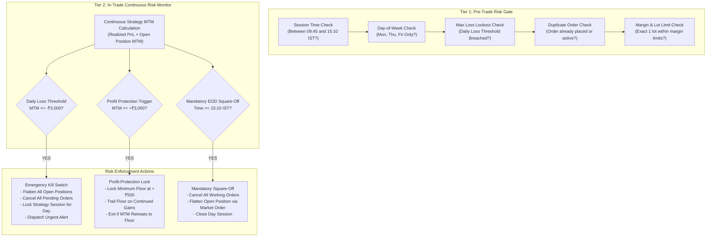

# Risk Controls & Circuit Breakers: MyTradeView

## 1. Executive Summary

Algorithmic derivatives trading on index options involves severe non-linear risks, including extreme gamma expansion, rapid market reversals, slippage, and broker communication disconnects. 

`MyTradeView` implements an institutional-grade, multi-tiered risk architecture. Risk rules operate at both the **pre-trade validation gate** and the **continuous in-trade monitoring engine**, backed by an unbypassable **kill switch**.

---

## 2. Multi-Tier Risk Architecture



---

## 3. Detailed Risk Rules & Enforcement

### 3.1 Daily Strategy MTM Loss Threshold (Hard Kill Switch: -₹3,000)
- **Rule Definition:** The cumulative strategy profit and loss (sum of all closed trades' realized PnL plus the live mark-to-market of any open option position) must not exceed a loss of **₹3,000**.
- **Calculation Formula:**
  $$\text{MTM}_{\text{strategy}} = \sum \text{PnL}_{\text{realized}} + (\text{LTP}_{\text{current}} - \text{Price}_{\text{entry}}) \times \text{Quantity} \times \text{Side}$$
- **Trigger Condition:**
  $$\text{MTM}_{\text{strategy}} \le -₹3,000.00$$
- **Enforcement Sequence:**
  1. The risk engine intercepts the tick and immediately activates the `KILL_SWITCH`.
  2. Any pending limit or working orders are cancelled.
  3. Active position is flattened immediately via an aggressive Market Order or FYERS Position Exit (`DELETE /api/v3/positions`).
  4. The strategy session state is updated in PostgreSQL to `LOCKED_OUT_FOR_DAY`.
  5. All future entry signals or reversal attempts are rejected until the next scheduled trading day.
  6. High-priority alert dispatched via Telegram / Slack / SMS.

---

### 3.2 Profit-Protection & Trailing Floor (+₹3,000 Trigger $\to$ +₹500 Floor)
- **Rule Definition:** When cumulative strategy MTM reaches **+₹3,000**, the profit protection mechanism is engaged to ensure a winning day does not collapse into a loss.
- **Initial Floor Activation:**
  - When $\text{MTM}_{\text{strategy}} \ge +₹3,000.00$, the **guaranteed minimum floor** is locked at **$+₹500.00$**.
- **Dynamic Trailing Logic (`lock_and_trail`):**
  - For every additional step increase in profit ($\Delta \text{Profit} = +₹1,000.00$), the locked profit floor trails upward by a fixed increment ($\Delta \text{Floor} = +₹500.00$).
  - **Trailing Formula:**
    $$\text{Steps} = \left\lfloor \frac{\text{MaxMTM} - 3000}{1000} \right\rfloor$$
    $$\text{Trailing Floor} = 500 + (\text{Steps} \times 500)$$
- **Exit Trigger:**
  - If strategy MTM retreats and touches or breaches the current locked floor:
    $$\text{MTM}_{\text{strategy}} \le \text{Trailing Floor}$$
  - The risk engine issues an immediate order to close the active position.
  - *Strategy Semantic Notice:* Once profit-protection exit is triggered, whether re-entries are permitted depends on configuration (`REENTRY_AFTER_PROFIT_PROTECTION`). By default, it locks profits and stops trading for the session.

---

### 3.3 Atomic Reversal Sequencing (Zero Naked Exposure)
- **The Problem:** When NIFTY reverses from above `OR_HIGH` to below `OR_LOW` (or vice versa), opening the reverse position before the existing position is closed can lead to double margin requirements, naked exposure during broker lag, or accidental straddles.
- **Enforced Execution Sequence:**
  ```
  [Breakout Reversal Detected]
                 │
                 ▼
  [Step 1: Submit Exit Order for Existing Leg]
                 │
                 ▼
  [Step 2: Await Broker Order Status = 2 (Traded)]
                 ├────────────────────────┐
                 ▼ (Success within 5s)    ▼ (Timeout / Delay)
  [Step 3: Submit Reverse Entry Order]   [Aggressive IOC Market Exit Retry]
                 │                                │
                 ▼                                ▼
       [Reverse Leg Filled]               [Await Fill Confirmation]
  ```
- **Rule Guarantee:** Under no circumstances will a reverse leg order be dispatched to the broker until the existing leg's fill confirmation is verified and recorded in the database.

---

### 3.4 Mandatory Square-Off (15:10 IST)
- **Rule Definition:** All positions must be intraday. Exchange MIS auto-square-off typically runs between 15:15 and 15:20 IST. To avoid broker auto-square-off penalties and unmanaged market-on-close slippage, `MyTradeView` initiates mandatory exit at **15:10:00 IST**.
- **Sequence:**
  1. At 15:10:00 IST, scheduler signals `MANDATORY_EOD_EXIT`.
  2. Order manager cancels any open entry/reversal orders.
  3. If an option position is open, submit market exit order.
  4. Verify position is flat (`net_qty == 0`).
  5. Transition strategy state to `SESSION_COMPLETED`.

---

### 3.5 Duplicate Entry & Process Crash Protection
- **The Problem:** High-frequency tick updates or multiple rapid candle closes could trigger duplicate orders. A process crash and restart could re-read the breakout and submit an unintended second order.
- **Controls Implemented:**
  1. **Deterministic Order Tag (`order_tag`):** Every order submitted to FYERS carries a client tag formatted as:
     $$\text{ORB\_}\{YYYYMMDD\}\_\{\text{SESSION\_ID}\}\_\{\text{LEG\_TYPE}\}\_\{\text{SEQUENCE}\}$$
     FYERS API v3 rejects orders with duplicate client IDs within the same trading day.
  2. **Database State Barrier:** Before dispatching an order, the order record is inserted into PostgreSQL with status `PENDING_SUBMISSION`. A unique constraint on `(session_date, leg_type, sequence)` physically blocks duplicate insertions.
  3. **Process Recovery Routine:** On startup, the executor queries PostgreSQL for existing session state and open positions, synchronizes with FYERS via `GET /api/v3/positions`, and resumes without re-initiating completed steps.

---

### 3.6 Broker Disconnection & WebSocket Drop Recovery
- **Heartbeat & Reconnect:** 
  - FYERS WebSocket connection maintains automated keep-alive pings.
  - If the socket disconnects, an exponential backoff reconnection routine runs ($1\text{s}, 2\text{s}, 4\text{s}, \dots, \max 30\text{s}$).
- **Reconciliation Poller:**
  - Independent background worker queries `GET /api/v3/positions` and `GET /api/v3/orders` every 5 seconds.
  - If an order fill occurred during a WebSocket disconnect, the reconciliation worker detects the state divergence, updates the local OMS, and synchronizes positions.
- **Stale Market Data Watchdog:**
  - If no tick is received for $> 30$ seconds during market hours (09:15 to 15:30), the system flags a `MARKET_DATA_STALE` warning and switches to REST quote polling.

---

### 3.7 Emergency Manual Kill Switch CLI
In the event of an unforeseen exchange anomaly, network black swan, or erroneous market feed, the operator can manually trigger the emergency kill switch from the terminal:

```bash
# Emergency Flatten Command
python -m src.risk.kill_switch --force-flatten --reason "Operator manual override"
```

This command bypasses all strategy logic, connects directly to FYERS API v3, cancels all pending orders, invokes `DELETE /api/v3/positions` with `exit_all=1`, records the action in the database audit log, and shuts down the executor.

