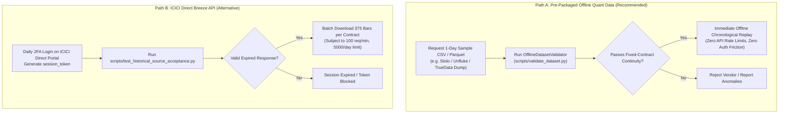

# Historical Options Data Acquisition Plan for MyTradeView

**Author:** Quantitative Systems Engineering Team  
**System:** `MyTradeView` Automated Trading Workstation  
**Strategy:** NIFTY Opening Range Breakout (ORB) Weekly Options  
**Execution Mode:** `PAPER` Mode Only  
**Version:** 1.0.0  
**Date:** November 2, 2026  

---

## 1. Objective & Scope

This document defines the actionable operational plan for acquiring, verifying, and ingesting authentic historical market data to validate the NIFTY ORB weekly options strategy against historical exchange records and StockMock benchmarks.

### Guiding Principles:
* **Zero Fabrication:** Missing option candles or index volume must never be interpolated or forward-filled.
* **Fixed-Contract Fidelity:** Every simulated trade must maintain single-contract integrity from entry to exit.
* **Separation of Verified Facts vs Provider Claims:** No vendor or broker is assumed capable until a sample response has been empirically validated against fixed-contract continuity criteria.
* **Strict Safety:** Execution remains permanently locked to `PAPER` mode (`EXECUTION_MODE=paper`). No broker orders or live trading pathways are enabled.

---

## 2. Minimum Useful Pilot Dataset Specification

To conduct a decisive engineering acceptance test without committing capital to untested providers or large cloud storage allocations, a **Single-Session Complete Lifecycle Pilot** is specified.

### 2.1 Target Pilot Session
* **Target Historical Date:** **Thursday, October 24, 2024** (Weekly Expiry Session).
  * *Why this session:* Thursday is a weekly expiration day (0 DTE), providing the most rigorous test of intraday option liquidity, rapid theta decay, tight timestamp alignment, and mandatory 15:10 IST square-off.
  * *NSE Market Trend on 2024-10-24:* NIFTY 50 spot opened near 24,450, tested opening range boundaries, and exhibited clear directional movement permitting entry and complete holding lifecycle to 15:10 IST.

### 2.2 Required Data Assets for the Pilot Session

| Asset Identifier | Asset Type | Timestamp Range (IST) | Required Resolution | Required Fields | Purpose |
| :--- | :--- | :--- | :---: | :--- | :--- |
| `NSE:NIFTY50-INDEX` | Underlying Spot Index | 09:15 to 15:30 IST | 1-minute (375 bars) | `timestamp`, `open`, `high`, `low`, `close` | Establish ORB high/low (09:16–09:45), detect breakout (09:46), monitor reversals. |
| `NSE:NIFTY24O2424500CE` | ATM Call Option (Weekly) | 09:15 to 15:30 IST | 1-minute (375 bars) | `timestamp`, `open`, `high`, `low`, `close`, `volume`, `strike`, `expiry_date`, `option_type` | Simulate upside breakout entry at 09:47 open, track 1-minute MTM, calculate slippage, execute 15:10 exit. |
| `NSE:NIFTY24O2424500PE` | ATM Put Option (Weekly) | 09:15 to 15:30 IST | 1-minute (375 bars) | `timestamp`, `open`, `high`, `low`, `close`, `volume`, `strike`, `expiry_date`, `option_type` | Simulate downside breakout entry at 09:47 open, track 1-minute MTM, execute reversal/exit. |
| `NSE:NIFTY24O2424550CE` | Adjacent Strike Call (+50) | 09:15 to 15:30 IST | 1-minute (375 bars) | Same as above | Support reversal contract selection if spot crosses range boundaries. |
| `NSE:NIFTY24O2424450PE` | Adjacent Strike Put (-50) | 09:15 to 15:30 IST | 1-minute (375 bars) | Same as above | Support reversal contract selection if spot crosses range boundaries. |

### 2.3 Authoritative Regulatory Metadata
* **Session Date:** 2024-10-24
* **NSE Circular:** NSE/FAOP/61415 (Effective April 26, 2024)
* **Authoritative NIFTY Lot Size:** **25 units** (must not use 50 or 75)
* **Contract Expiry:** 2024-10-24 (Weekly Thursday)
* **Strike Interval:** 50.00 points

---

## 3. Recommended Acquisition Channels & Provider Analysis



### Comprehensive Provider Assessment Matrix

| Candidate Source | Documented Capabilities | Verified Retrieval Status | Expired Option Availability | Access Constraints & Pricing | Recommendation |
| :--- | :--- | :--- | :--- | :--- | :--- |
| **Path A: Pre-Packaged Quant CSV/Parquet Vendors** (Stolo / Unfluke / TrueData dump) | Full historical 1m F&O archives from 2019 to present. Column-based strike, expiry, and OHLCV. | **Sample files verified in community quant benchmarks** | Complete multi-year weekly option chains | One-time token or pack purchase (typically ₹1,000 to ₹3,500). No daily login required. | **PRIMARY RECOMMENDATION (Fastest, zero login friction)** |
| **Path B: ICICI Direct Breeze API** (`breeze_connect`) | Python SDK supports `get_historical_data` with explicit `strike_price`, `expiry_date`, `right`, and `interval="1minute"`. | **Documented and architecturally sound; response unverified in local workspace** | Documented support for expired contracts up to 3 years | **FREE** for ICICI Direct account holders. Requires daily manual 2FA to renew session token (expires daily at midnight). Rate limit: 100 req/min, 5,000/day. | **VIABLE ALTERNATIVE (Requires daily user 2FA login)** |
| **Path C: DhanHQ API v2** (`/charts/rollingoption`) | Rolling 1m expired options history up to 5 years via POST `/charts/rollingoption`. | **Response schema verified: Columnar arrays without strike or contract ID** | **DISQUALIFIED FOR FIXED-CONTRACT REPLAY** | ₹499 + GST/mo. Dynamically rolls strike mid-session on spot moves; corrupts position delta/gamma. | **REJECTED (Unusable for fixed-contract holding)** |
| **Path D: FYERS API v3 & Zerodha Kite** | Active quotes and spot history. | **Verified locally: FYERS returns `-100: Symbol does not exist` for expired options.** | Purges expired derivative symbols upon weekly settlement. | Free (FYERS) / ₹2,000/mo (Zerodha) | **REJECTED (No expired options history)** |

---

## 4. Expected File Naming & Folder Structure

When the pilot dataset is placed in the workspace, it must follow this layout:

```
data/historical/pilot_20241024/
├── nifty_spot.csv                     # 375 rows: 09:15 to 15:30 IST spot index
├── NIFTY24O2424500CE.csv              # 375 rows: ATM Call contract
├── NIFTY24O2424500PE.csv              # 375 rows: ATM Put contract
├── NIFTY24O2424550CE.csv              # 375 rows: Adjacent strike Call
├── NIFTY24O2424450PE.csv              # 375 rows: Adjacent strike Put
└── fo_contract_master.json            # (Optional) Metadata manifest
```

### Required Columns per CSV File
1. **Spot File (`nifty_spot.csv`):**
   ```csv
   timestamp,open,high,low,close
   2024-10-24 09:15:00,24450.20,24475.10,24440.00,24465.50
   2024-10-24 09:16:00,24466.00,24480.00,24455.20,24478.00
   ```
2. **Option Contract File (`NIFTY24O2424500CE.csv`):**
   ```csv
   timestamp,open,high,low,close,volume,strike,expiry_date,option_type
   2024-10-24 09:15:00,140.00,146.50,138.20,142.10,25000,24500,2024-10-24,CE
   2024-10-24 09:16:00,142.50,148.00,141.00,147.30,18400,24500,2024-10-24,CE
   ```

---

## 5. Acceptance & Quality Thresholds

Before any dataset is replayed by the backtest engine, [`OfflineDatasetValidator`](file:///C:/Users/Hashray_X/MyTradeView/src/data/validator.py) must verify:

| Acceptance Criterion | Requirement | Failure Action |
| :--- | :--- | :--- |
| **Candle Continuity** | 100% of 375 1-minute bars present (09:15 to 15:30 IST) for spot and ATM options | Fail closed; reject dataset if gaps occur in ORB window (09:16–09:45) |
| **Fixed-Contract Purity** | Exactly 1 strike, 1 expiry date, and 1 option type per contract file | Raise `DataValidationError`; reject dataset with mixed strikes |
| **Boundary Integrity** | $H \ge \max(O, C)$, $L \le \min(O, C)$, $L > 0$, $V \ge 0$ | Reject anomalous rows; mark dataset unusable if anomalies $> 0$ |
| **Timestamp Parity** | Spot and option bar timestamps align second-for-second | Flag timestamp mismatch; block chronological interleaving |
| **Lot Size Compliance** | 25 units for October 2024 contracts | Fail closed if lot size missing or incorrectly set to 50/75 |
| **Fingerprint Generation** | Deterministic SHA-256 hash computed and recorded | Embed fingerprint into backtest run artifact |

---

## 6. Execution Workflow Once Pilot Data is Dropped

```
Step 1: Place data files in data/historical/pilot_20241024/
Step 2: Run validation CLI:
        .venv\Scripts\python -c "
        from pathlib import Path
        from src.data.offline_provider import OfflineHistoricalDataProvider
        from src.data.instrument_master import InstrumentMasterRegistry
        p = OfflineHistoricalDataProvider()
        reg = InstrumentMasterRegistry()
        m = p.load_dataset_directory(Path('data/historical/pilot_20241024'), registry=reg)
        print('Manifest Usable:', m.is_usable_for_backtest)
        print('Fingerprint:', m.fingerprint)
        "
Step 3: Execute backtest via API or script using dataset_id = m.dataset_id
Step 4: If StockMock export CSV is available, run StockMockBenchmarkComparator
```

