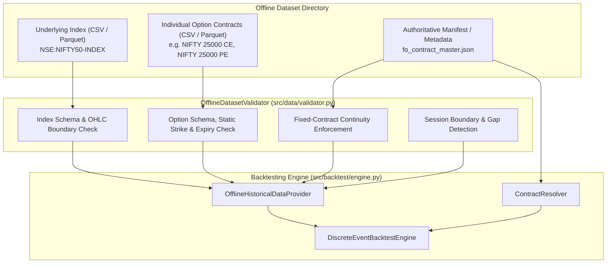

# Historical Options Dataset Specification for MyTradeView

**System:** `MyTradeView` Automated Trading Workstation  
**Strategy:** NIFTY Opening Range Breakout (ORB) Weekly Options  
**Execution Mode:** `PAPER` Mode Only  
**Version:** 1.0.0  
**Date:** November 2, 2026  

---

## 1. Purpose & Scope

This specification defines the authoritative schema, validation constraints, column mappings, and metadata rules for authentic historical market datasets ingested by `MyTradeView` for offline backtesting and StockMock parity calibration.

### Core Architecture Principles:
1. **Zero Synthetic Fabrication:** Missing index volume, option open interest, or missing candles must NEVER be fabricated, interpolated, or forward-filled.
2. **Fixed-Contract Continuity:** An option position entered by the strategy (e.g. ATM 25,000 CE at 09:47:00 IST) must be tracked using the exact, unchanging contract until exit. Datasets mixing multiple strikes, expiries, or rolling moneyness series into a single contract stream are strictly rejected.
3. **No File-Name Guesswork:** Contract metadata (strike, expiry, option type, underlying) must be unambiguously declared within file headers, dedicated columns, or an accompanying authoritative manifest—never silently inferred from ambiguous file-naming conventions.
4. **Dynamic Lot Size Accounting:** Historical lot sizes must match official NSE regulatory schedules (50 units pre-April 2024, 25 units April–Nov 2024, 75 units post-Nov 2024). Hardcoding current lot sizes retroactively is strictly prohibited.

---

## 2. Dataset Category Specifications

Datasets are divided into two distinct asset classes: **Underlying Index Data** and **Individual Option Contract Data**.



---

### Category A: Underlying Index Data (`NSE:NIFTY50-INDEX`)

Underlying index candles establish the Opening Range High (`OR_HIGH`) and Low (`OR_LOW`) between 09:16:00 and 09:45:00 IST, confirm breakouts at candle closes (09:46:00+), and trigger reversal exits.

#### Required Fields

| Field Name | Type | Constraints | Description |
| :--- | :--- | :--- | :--- |
| `timestamp` | `datetime` or `epoch` | Non-null, strictly ascending, no duplicates | Bar start timestamp. If naive string, interpreted as IST (`Asia/Kolkata`). Converted internally to UTC. |
| `open` | `Decimal` | $\text{open} > 0$ | Bar opening price. |
| `high` | `Decimal` | $\text{high} \ge \max(\text{open}, \text{close}, \text{low})$ | Bar highest price. |
| `low` | `Decimal` | $\text{low} \le \min(\text{open}, \text{close}, \text{high}), \text{low} > 0$ | Bar lowest price. |
| `close` | `Decimal` | $\text{close} > 0$ | Bar closing price. |

#### Optional Fields

| Field Name | Type | Constraints | Description |
| :--- | :--- | :--- | :--- |
| `volume` | `integer` | $\ge 0$ if present | Index trading volume. **May be unavailable for cash index.** If missing, set to 0. Must **never** be fabricated. |
| `symbol` | `string` | Canonical: `NSE:NIFTY50-INDEX` | Trading symbol identifier. If omitted from rows, must be specified in metadata. |

---

### Category B: Individual Option Contract Data

Option candles simulate order execution fills (at `next_bar_open`), track 1-minute mark-to-market (MTM), evaluate profit-protection floors, and execute square-offs.

#### Required Fields

| Field Name | Type | Constraints | Description |
| :--- | :--- | :--- | :--- |
| `underlying` | `string` | Must be `NIFTY` or `NSE:NIFTY50-INDEX` | Underlying asset symbol. |
| `expiry_date` | `date` (`YYYY-MM-DD`) | Valid NSE Thursday/Wednesday settlement | Contract expiration date. Must match across all rows in the contract series. |
| `strike` | `Decimal` | Positive multiple of 50.00 (e.g. `24500.00`) | Exact strike price. Must be identical across all rows in the series. |
| `option_type` | `string` | Strictly `"CE"` or `"PE"` | Option type. Must not mix CE and PE in a single contract series. |
| `timestamp` | `datetime` or `epoch` | Non-null, strictly ascending, no duplicates | 1-minute bar start timestamp. |
| `open` | `Decimal` | $\text{open} > 0$ | Contract opening price in INR. |
| `high` | `Decimal` | $\text{high} \ge \max(\text{open}, \text{close}, \text{low})$ | Contract highest price in INR. |
| `low` | `Decimal` | $\text{low} \le \min(\text{open}, \text{close}, \text{high}), \text{low} > 0$ | Contract lowest price in INR. |
| `close` | `Decimal` | $\text{close} > 0$ | Contract closing price in INR. |

#### Optional Fields

| Field Name | Type | Constraints | Description |
| :--- | :--- | :--- | :--- |
| `volume` | `integer` | $\ge 0$ if present | Traded contract volume. Retained if present, never fabricated. |
| `open_interest` | `integer` | $\ge 0$ if present | End-of-minute open interest. Retained if present, never fabricated. |
| `implied_volatility` | `Decimal` | $\ge 0$ if present | Source-calculated IV. Retained if present. |
| `symbol` | `string` | Canonical or vendor symbol | Specific contract identifier (e.g. `NSE:NIFTY24O2424500CE`). |

---

## 3. Supported Input Formats & Column Mapping

The offline validation engine accepts both **CSV** (UTF-8, comma-delimited) and **Apache Parquet** files.

### 3.1 Accepted Header Aliases (Case-Insensitive)

The ingestion layer maps common vendor column aliases to canonical internal names:

| Canonical Field | Accepted Header Aliases |
| :--- | :--- |
| `timestamp` | `timestamp`, `datetime`, `date_time`, `date`, `time`, `ts`, `candle_time` |
| `open` | `open`, `open_price`, `o`, `first` |
| `high` | `high`, `high_price`, `h`, `max` |
| `low` | `low`, `low_price`, `l`, `min` |
| `close` | `close`, `close_price`, `c`, `last`, `ltp` |
| `volume` | `volume`, `vol`, `v`, `qty`, `traded_qty` |
| `open_interest`| `open_interest`, `openinterest`, `oi` |
| `strike` | `strike`, `strike_price`, `strikeprice`, `sp` |
| `option_type` | `option_type`, `optiontype`, `opt_type`, `type`, `right`, `call_put` |
| `expiry_date` | `expiry_date`, `expiry`, `exp_date`, `expiration` |
| `underlying` | `underlying`, `underlying_symbol`, `index_name`, `symbol` |

---

## 4. Symbology & Vendor Mapping Rules

When datasets use provider-specific symbol formats, they must map to canonical exchange identifiers:

### 4.1 Canonical Exchange Format
`NSE:NIFTY<YY><M/MMM><DD><STRIKE><TYPE>`  
Examples:
- Weekly Expiry: `NSE:NIFTY24OCT2424500CE` (or FYERS format: `NSE:NIFTY24O2424500CE`)
- Monthly Expiry: `NSE:NIFTY24OCT24500CE`

### 4.2 Ambiguous File-Name Policy
> [!CRITICAL]
> **Files named ambiguously (e.g. `data_01.csv` or `nifty_oct_call.csv`) without internal strike and expiry columns will be REJECTED.**  
> The ingestion engine will NEVER guess a strike price or expiry date from a file name. Contract specifications must be explicitly declared within the file schema or via `fo_contract_master.json`.

---

## 5. Fixed-Contract Continuity Enforcement

The backtest engine enforces strict **fixed-contract identity**:

```
[VALID FIXED-CONTRACT STREAM]
Time: 09:47 -> Strike: 24500, Expiry: 2024-10-24, Type: CE
Time: 09:48 -> Strike: 24500, Expiry: 2024-10-24, Type: CE
Time: 09:49 -> Strike: 24500, Expiry: 2024-10-24, Type: CE
...
Time: 15:10 -> Strike: 24500, Expiry: 2024-10-24, Type: CE
Result: ACCEPTED (Static Contract Maintained)

[INVALID ROLLING STREAM (e.g. Dhan /charts/rollingoption)]
Time: 09:47 -> Strike: 24500 (Spot = 24510)
Time: 10:15 -> Strike: 24550 (Spot moved to 24560 - ROLLED!)
Time: 11:30 -> Strike: 24600 (Spot moved to 24610 - ROLLED!)
Result: REJECTED (Contract-switching contamination detected)
```

The validation layer rejects:
1. **Strike Mixing:** A single file or stream containing multiple distinct strike values without contract separation.
2. **Expiry Mixing:** Candles belonging to different expiration dates merged into one series.
3. **Type Mixing:** Interleaved CE and PE records within the same contract identifier.
4. **Duplicate Timestamps:** More than one candle for the same contract at the same timestamp.

---

## 6. Historical Lot Size & Contract Master Requirements

### 6.1 Regulatory Lot Size Schedule
Contract lot sizes must match official NSE regulatory circulars:

| Historical Date Window | Authoritative NIFTY Lot Size | Regulatory Authority |
| :--- | :---: | :--- |
| **Up to April 25, 2024** | **50** | Standard NSE F&O Framework |
| **April 26, 2024 to November 19, 2024** | **25** | NSE Circular NSE/FAOP/61543 |
| **November 20, 2024 Onward** | **75** | SEBI Circular SEBI/HO/MRD/MRD-PoD-2/P/CIR/2024/133 |

### 6.2 Historical Contract Master Specification (`fo_contract_master.json`)
When backtesting historical sessions, an accompanying historical contract manifest must be provided to [`ContractResolver`](file:///C:/Users/Hashray_X/MyTradeView/src/data/contract_resolver.py):

```json
{
  "session_date": "2024-10-24",
  "underlying": "NSE:NIFTY50-INDEX",
  "spot_close_0945": 24520.50,
  "resolved_expiry": "2024-10-24",
  "lot_size": 25,
  "tick_size": 0.05,
  "available_contracts": [
    {
      "symbol": "NSE:NIFTY24O2424500CE",
      "strike": 24500.0,
      "option_type": "CE",
      "expiry": "2024-10-24",
      "lot_size": 25,
      "file_path": "options/NIFTY24O2424500CE.parquet"
    },
    {
      "symbol": "NSE:NIFTY24O2424500PE",
      "strike": 24500.0,
      "option_type": "PE",
      "expiry": "2024-10-24",
      "lot_size": 25,
      "file_path": "options/NIFTY24O2424500PE.parquet"
    }
  ]
}
```

If historical lot size or contract metadata is unavailable, the validation harness marks the affected session as `BLOCKED — INCOMPLETE HISTORICAL METADATA`. It will **never** silently default to 25 or 75.

---

## 7. Session Calendar & Gap Detection Rules

1. **Market Hours:** Standard NSE equity derivative trading sessions run strictly from **09:15:00 to 15:30:00 IST** (375 continuous 1-minute bars).
2. **Opening Range Window:** Bars between **09:16:00 and 09:45:00 IST** (30 bars) are strictly required for range establishment. Missing any bar in this window invalidates the session.
3. **Square-Off Bar:** The 15:10:00 IST bar is strictly required for mandatory EOD square-off.
4. **Boundary Distinction:**
   * **Expected Gaps:** Inter-session gaps (overnight from 15:30 to 09:15 next trading day, weekends, and official NSE holidays) are expected and valid.
   * **Unexpected Gaps:** Any missing 1-minute interval ($\Delta t > 1\text{ min}$) between 09:15:00 and 15:29:59 IST on a trading session is an unexpected gap and must be logged in `DataQualityReport.known_gaps`.

---

## 8. Cryptographic Dataset Fingerprint

Every validated dataset generates a deterministic **SHA-256 fingerprint**:
$$\text{Fingerprint} = \text{SHA-256}(\text{Canonical Interleaved Canonical Row Stream})$$
* Computed over: `[symbol, timestamp_utc_iso, open, high, low, close, volume]`
* The fingerprint is recorded in `BacktestRunRecord.dataset_id` as `HIST_DATA_<sha256[:16]>`.
* Guarantees 100% auditability and ensures backtest results can be traced to the exact raw data bits replayed.

